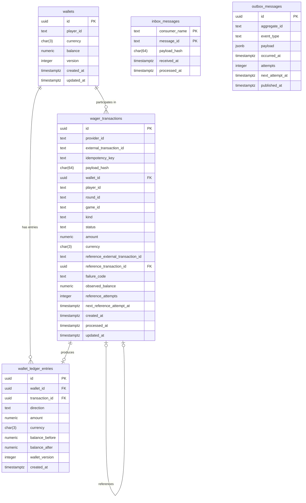

# Arquitetura — Distributed Wagering Processor

## Visão Geral

Serviço financeiro distribuído de alta concorrência para processamento de apostas.

## Decisões (ADRs)

### ADR 1: Uso do MikroORM com EntitySchema

- **Contexto:** Necessidade de manter o domínio desacoplado de detalhes de banco de dados e ORMs.
- **Decisão:** Utilizar MikroORM com definição via `EntitySchema` e mappers manuais.
- **Consequências:** Isolamento completo do domínio em relação à persistência.

### ADR 2: Injeção de Dependência Explícita

- **Contexto:** O NestJS depende nativamente de reflexão (`emitDecoratorMetadata`), que pode conflitar com certas restrições do Bun ou arquiteturas puras.
- **Decisão:** Uso estrito de tokens explícitos (`@Inject(TOKEN)`).

### ADR 3: Emulador SQS via LocalStack

- **Contexto:** Necessidade de testar mensageria SQS FIFO localmente sem dependência de nuvem real.
- **Decisão:** Uso do LocalStack para SQS.

### ADR 4: Value Object Money com escala fixa e ausência de arredondamento

- **Contexto:** Cálculos financeiros sujeitos a erros de ponto flutuante binário (`number`) e inconsistências de arredondamento implícito violam a correção contábil do sistema.
- **Decisão:** Criamos o Value Object imutável `Money` utilizando uma instância isolada de `decimal.js` configurada sem arredondamentos implícitos (`ROUND_DOWN`, precisão 28). Nenhuma operação produz mais de 2 casas decimais. `Money.from` valida formato estrito `^-?(0|[1-9]\d{0,16})\.\d{2}$` (rejeitando `-0.00`, espaços, zeros à esquerda e notação científica), enquanto `Money.fromContract` rejeita estritamente valores negativos para entradas de borda (HTTP/SQS).
- **Consequências:** Garantia absoluta de precisão aritmética (`0.10 + 0.20 = 0.30`), imutabilidade estrutural e rejeição em tempo de execução de qualquer representação monetária ambígua.

### ADR 5: Versão da Wallet no Ledger (`walletVersion`) e integridade contábil

- **Contexto:** Toda alteração de saldo da `Wallet` precisa ser estritamente correlacionada a um lançamento de auditoria imutável, permitindo ordenação, concorrência e chave única para consistência.
- **Decisão:** Incluir `walletVersion: number` em `WalletLedgerEntry` representando a versão da carteira resultante da movimentação (`UNIQUE(wallet_id, wallet_version)`). O agregado `Wallet` incrementa sua versão estritamente quando o saldo muda (`debit` e `credit`) e emite o lançamento de ledger correspondente no mesmo ato. A factory `WalletLedgerEntry.create` verifica a igualdade estrita `balanceBefore ± money === balanceAfter`.
- **Consequências:** Impossibilidade de desvio entre o saldo da carteira e o histórico do ledger. Caso ocorra erro de saldo insuficiente (`InsufficientFundsError`), a carteira mantém seu estado original intocado.

### ADR 6: Máquina de estados de WagerTransaction, Política de Liquidação e Hash Canônico

- **Contexto:** Transações de apostas (`BET`, `WIN`, `LOSS`, `REFUND`, `ROLLBACK`) requerem controle financeiro estrito, auditoria imutável de transições, resolução assíncrona de referências fora de ordem e deduplicação idempotente sem colisão de payloads.
- **Decisão:**
  1. **Máquina de Estados de `WagerTransaction`:**
     - Estados: `PENDING`, `PENDING_REFERENCE`, `PROCESSED`, `REJECTED`, `FAILED`.
     - Estados terminais imutáveis: `PROCESSED`, `REJECTED`, `FAILED`. Qualquer transição a partir de um estado terminal ou transição inválida lança `InvalidTransactionStateError`.
     - Tabela de transições válidas:
       | Estado Inicial | Evento / Método | Estado Destino | Condições |
       |---|---|---|---|
       | `(novo)` | `create(props)` | `PENDING` | REFUND/ROLLBACK exigem referência externa; money > 0 (LOSS >= 0) |
       | `PENDING` | `markProcessed(...)` | `PROCESSED` | Sucesso financeiro; grava `observedBalance` |
       | `PENDING` | `markPendingReference(...)`| `PENDING_REFERENCE` | Referência ausente ou ainda em processamento |
       | `PENDING` | `reject(code, ...)` | `REJECTED` | Rejeição de negócio; grava `observedBalance` |
       | `PENDING` | `fail(code)` | `FAILED` | Erro permanente de infraestrutura |
       | `PENDING_REFERENCE` | `scheduleReferenceRetry(...)` | `PENDING_REFERENCE` | Incrementa `referenceAttempts` e agenda nova data |
       | `PENDING_REFERENCE` | `markProcessed(...)` | `PROCESSED` | Referência processada com sucesso |
       | `PENDING_REFERENCE` | `reject(code, ...)` | `REJECTED` | Violação de regra ou tentativas esgotadas (`REFERENCE_NOT_FOUND`) |
       | `PENDING_REFERENCE` | `fail(code)` | `FAILED` | Erro permanente de infraestrutura |

  2. **Taxonomia de Códigos de Falha (`FailureCode`) e Ação Recomendada ao Provedor:**
     | FailureCode | Significado | Ação Sugerida ao Provedor |
     |---|---|---|
     | `INSUFFICIENT_FUNDS` | Saldo insuficiente para efetuar `BET` | Não reenviar; aguardar depósito do jogador |
     | `REVERSAL_WOULD_OVERDRAW` | Reversão (débito) deixaria saldo da carteira negativo | Intervenção manual / conciliação financeira |
     | `REFERENCE_NOT_FOUND` | Transação referenciada não encontrada após limite de retries | Reenviar após verificar status da transação de origem |
     | `REFERENCE_MISMATCH` | Inconsistência de player, wallet, moeda ou rodada com a referência | Corrigir payload da requisição antes de reenviar |
     | `REFERENCE_NOT_PROCESSED` | Transação de referência terminou em `REJECTED` ou `FAILED` | Não reenviar; transação de origem não possui efeito financeiro |
     | `INVALID_REFERENCE_KIND` | Tipo de operação referenciada incompatível com o tipo da reversão | Corrigir payload da requisição (verificar tipo da referência) |
     | `REFERENCE_AMOUNT_MISMATCH` | Valor do REFUND/ROLLBACK diferente do valor exato da referência | Corrigir payload com o valor exato da transação original |
     | `ALREADY_REVERSED` | Transação de referência já foi revertida anteriormente | Não reenviar; reversão já consumida |
     | `CURRENCY_MISMATCH` | Moeda da operação difere da moeda contratada da carteira | Corrigir payload com a moeda correspondente à carteira |
     | `PLAYER_WALLET_MISMATCH` | `playerId` informado na operação não é o proprietário da wallet | Corrigir payload associando o jogador correto |
     | `PERMANENT_INFRASTRUCTURE_ERROR` | Falha terminal de infraestrutura sem possibilidade de auto-recuperação | Intervenção manual da equipe de engenharia |

  3. **Interpretações Adotadas na Liquidação (`SettlementPolicy`):**
     - `WIN` e `LOSS` com referência opcional: Quando fornecida, a referência deve obrigatoriamente apontar para uma `BET` da mesma rodada, carteira e jogador.
     - Reversão única: Uma transação referenciada só pode ser revertida uma única vez (`existingReversal` bloqueia qualquer tentativa subsequente).
     - Referência pendente: Se a transação referenciada estiver `PENDING` ou `PENDING_REFERENCE`, a dependente entra/permanece em `PENDING_REFERENCE`.
     - Pureza: `SettlementPolicy` é puramente funcional e não aplica mutações em entidades ou agregados.

  4. **Algoritmo do `payloadHash`:**
     - Baseado em SHA-256 hex sobre representação canônica recursiva (`canonicalJson`).
     - Chaves de objetos são ordenadas lexicograficamente de forma recursiva; delimitadores sem espaços (`{"a":1,"b":2}`).
     - Propriedades com valor `null` ou `undefined` são estritamente omitidas.
     - Objetos monetários `Money` são canonicamente representados por `{ "amount": "xx.xx", "currency": "YYY" }`.
     - Campos participantes: `providerId`, `externalTransactionId`, `playerId`, `walletId`, `roundId`, `gameId`, `kind`, `money`, `referenceExternalTransactionId` (quando presente).
     - Metadados de transporte (`Idempotency-Key`, `messageId`, headers HTTP, timestamps de fila) são excluídos do hash.
- **Consequências:** Integridade semântica determinística, auditoria inequívoca de transições e idempotência estrita independentemente do canal de ingestão (HTTP vs SQS).

### ADR 7: Schema do Banco de Dados, Constraints e Garantias Estruturais de Auditoria

- **Contexto:** Em sistemas de liquidação financeira distribuída (README §5.9), regras de negócio e integridade monetária não podem residir exclusivamente no código de aplicação. O banco de dados PostgreSQL deve ser o guardião definitivo contra concorrência destrutiva, duplicações de crédito/débito, race conditions e violações de auditoria contábil.
- **Decisão:**
  1. **Tabelas e Restrições Estruturais:**
     - `wallets`: Unicidade garantida por `UNIQUE(player_id, currency)`. Não-negatividade imposta por `CHECK(balance >= 0)`. Concorrência otimista resguardada por `CHECK(version >= 1)` e formato ISO por `CHECK(currency ~ '^[A-Z]{3}$')`.
     - `wager_transactions`: Idempotência garantida duplamente por `UNIQUE(idempotency_key)` e `UNIQUE(provider_id, external_transaction_id)`. Coerência de estados assegurada por constraints estritas (`CHECK failure_code` coerente com `REJECTED`/`FAILED`; `CHECK processed_at` coerente com `PROCESSED`; `CHECK reference_external_transaction_id` obrigatório para `REFUND`/`ROLLBACK`).
     - **Reversão Única:** Protegida no schema através de índice único parcial:
       `CREATE UNIQUE INDEX uq_idx_wager_transactions_processed_reversal ON wager_transactions (reference_transaction_id) WHERE status = 'PROCESSED' AND kind IN ('REFUND', 'ROLLBACK');`
     - **Políticas de Imutabilidade e Auditoria em `wager_transactions`:** Triggers PL/pgSQL bloqueiam qualquer mutação (`UPDATE`) sobre transações em estados terminais (`PROCESSED`, `REJECTED`, `FAILED`), proíbem modificação de colunas imutáveis/identidade (`provider_id`, `wallet_id`, `kind`, `amount`, etc.), e proíbem terminantemente `DELETE` de transações.
     - `wallet_ledger_entries`: Livro-razão estritamente **append-only**. Constraints verificam a aritmética exata de cada linha (`DEBIT` exige `balance_after = balance_before - amount`; `CREDIT` exige `balance_after = balance_before + amount`). Chave `UNIQUE(transaction_id, wallet_id)` assegura no máximo um lançamento por carteira por transação financeira. Chave `UNIQUE(wallet_id, wallet_version)` previne forks contábeis. Triggers `BEFORE UPDATE OR DELETE` (row-level) e `BEFORE TRUNCATE` (statement-level) impedem mutação, exclusão ou truncamento acidental.
     - `inbox_messages`: Chave primária composta `PRIMARY KEY (consumer_name, message_id)` impede duplicidade de ingestão e viabiliza redelivery idempotente.
     - `outbox_messages`: Índice parcial `(COALESCE(next_attempt_at, occurred_at)) WHERE published_at IS NULL` otimiza o claim concorrente de eventos pendentes para publicação com `SKIP LOCKED`.
  2. **Avaliação do Constraint Trigger Deferrable para Saldo da Wallet:**
     - A constraint trigger opcional diferida (`DEFERRABLE INITIALLY DEFERRED`) que validaria `wallets.balance = last ledger balance_after` no momento do commit foi avaliada. Em cenários de alta concorrência em hot wallets e pipelines transacionais que manipulam operações sem efeito no saldo (como `LOSS` ou rejeições que registram auditoria sem criar lançamento contábil), esse trigger impõe lock adicional e acoplamento desnecessário, uma vez que a invariante contábil já é resguardada deterministicamente pelo Unit of Work da aplicação (`Wallet` aggregate + `wallet_ledger_entries`), pelo optimistic locking (`version`) e pelas constraints de não-negatividade e unicidade de versão (`UNIQUE(wallet_id, wallet_version)`). Optou-se por não aplicá-la no schema para resguardar a latência e o throughput de hot wallets.
- **Consequências:** Impossibilidade de corrupção de saldo, lost updates ou adulteração contábil mesmo sob falha catastrófica de código ou acesso concorrente direto ao banco.

### ADR 8: Estratégia de Persistência com MikroORM, Unit of Work Transacional e SQL Cru nos Caminhos Críticos

- **Contexto:**
  O sistema exige garantias financeiras rigorosas sob concorrência intensa: row locking em wallets com timeout configurável, garantias estritas de atomicidade entre inbox, wallet, ledger, transação e outbox, além de ausência absoluta de vazamento do ORM para o domínio de negócio.
- **Decisão:**
  1. **MikroORM desacoplado via EntitySchema e Mappers:**
     - O domínio permanece 100% puro, sem anotações ou herança de classes do ORM ou do NestJS.
     - A persistência relacional é mapeada por `EntitySchema` independentes (`WalletEntitySchema`, `WagerTransactionEntitySchema`, `WalletLedgerEntryEntitySchema`).
     - Todas as colunas monetárias `numeric(19,2)` são mapeadas explicitamente como `string` para eliminar risco de conversão implícita para IEEE-754 `number`.
     - Mappers estáticos explícitos realizam a conversão bidirecional entre linhas de persistência e entidades do domínio utilizando `Money.from({ amount, currency })` e as fábricas `rehydrate`.
  2. **Unit of Work e Contexto Assíncrono com AsyncLocalStorage:**
     - Cada execução `unitOfWork.run(fn)` cria um novo fork isolado de `EntityManager` (`em.fork()`), garantindo identity map limpo sem estado residual entre execuções concorrentes.
     - A transação é aberta via `em.transactional` com isolamento `READ COMMITTED`.
     - O `EntityManager` transacional ativo é mantido em `AsyncLocalStorage`. Chamadas aninhadas a `run` dentro do mesmo contexto assíncrono detectam a transação ativa e a reutilizam de forma transparente.
     - Timeout de aquisição de lock (`SET LOCAL lock_timeout = '...ms'`) é configurado automaticamente na abertura de cada transação (usando `DB_LOCK_TIMEOUT_MS`).
     - Callbacks de pós-commit (`afterCommit(fn)`) são disparados exclusivamente após o commit bem-sucedido da transação raiz.
  3. **SQL Cru nos Caminhos Críticos de Concorrência e Auditoria:**
     - As operações de alta semântica contábil e de concorrência (`SELECT ... FOR UPDATE`, `INSERT ... ON CONFLICT DO NOTHING`, `UPDATE ... WHERE version = ?`, `INSERT` imutável no ledger) são executadas através de SQL cru parametrizado (`em.execute`) sobre a conexão transacional ativa, evitando o mecanismo automático de dirty checking (`persist/flush`) do ORM nesses caminhos sensíveis.
     - A interface `LedgerRepository` expõe unicamente o método `append(entry)`. Não existem métodos de alteração (`update`) ou exclusão (`delete`), em perfeita consonância com as triggers do banco.
  4. **Classificação e Normalização de Erros do PostgreSQL:**
     - Erros de lock timeout (`55P03`) são convertidos em `LockTimeoutError` (transitório).
     - Deadlocks (`40P01`), falhas de serialização (`40001`) e desconexões/falhas de rede são convertidos em `TransientInfrastructureError`.
     - Conflitos de concorrência otimista (`updateBalance` afetando 0 linhas) lançam `WalletVersionConflictError` (transitório).
     - Violações de unicidade (`23505`) são mapeadas para `UniqueConstraintViolationError`, expondo a constraint violada.
- **Consequências:**
  Concorrência segura e previsível sem starvation nem locks eternos, total desacoplamento arquitetural entre regras contábeis e biblioteca de persistência, e tratamento transparente de retries transitórios em camadas superiores.

### Modelo de Dados (Diagrama ER)

### Mapeamento: Garantia Contábil/Concorrência → Mecanismo no Schema

| Garantia / Invariante | Mecanismo Implementado no Schema | Tabela / Objeto |
|---|---|---|
| No máximo uma carteira por jogador e moeda | `UNIQUE (player_id, currency)` | `wallets` |
| Saldo da carteira nunca negativo | `CHECK (balance >= 0)` | `wallets` |
| Versão de concorrência estritamente positiva | `CHECK (version >= 1)` | `wallets` |
| Formato de moeda estrito ISO-4217 | `CHECK (currency ~ '^[A-Z]{3}$')` | `wallets`, `wager_transactions`, `wallet_ledger_entries` |
| Idempotência por chave de requisição | `UNIQUE (idempotency_key)` | `wager_transactions` |
| Idempotência por provedor e ID externo | `UNIQUE (provider_id, external_transaction_id)` | `wager_transactions` |
| Valor monetário da transação não-negativo | `CHECK (amount >= 0)` | `wager_transactions` |
| Coerência do código de falha | `CHECK ((failure_code IS NOT NULL AND status IN ('REJECTED','FAILED')) OR (failure_code IS NULL AND status NOT IN ('REJECTED','FAILED')))` | `wager_transactions` |
| Coerência do timestamp de processamento | `CHECK ((processed_at IS NOT NULL AND status = 'PROCESSED') OR (processed_at IS NULL AND status <> 'PROCESSED'))` | `wager_transactions` |
| Obrigatoriedade de referência para reversões | `CHECK ((kind IN ('REFUND','ROLLBACK') AND reference_external_transaction_id IS NOT NULL) OR (kind NOT IN ('REFUND','ROLLBACK')))` | `wager_transactions` |
| Reversão única de transação processada | `CREATE UNIQUE INDEX ... (reference_transaction_id) WHERE status = 'PROCESSED' AND kind IN ('REFUND', 'ROLLBACK')` | `wager_transactions` |
| Polling eficiente de referências pendentes | `CREATE INDEX ... (next_reference_attempt_at) WHERE status = 'PENDING_REFERENCE'` | `wager_transactions` |
| Imutabilidade de transação em estado terminal | Trigger `BEFORE UPDATE` com `RAISE EXCEPTION` | `wager_transactions` |
| Imutabilidade de colunas de identidade | Trigger `BEFORE UPDATE` bloqueia alteração de dados de negócio | `wager_transactions` |
| Auditoria: proibição de exclusão de transações | Trigger `BEFORE DELETE` com `RAISE EXCEPTION` | `wager_transactions` |
| Lançamento contábil com valor estritamente positivo | `CHECK (amount > 0)` | `wallet_ledger_entries` |
| Saldos contábeis anterior e posterior não-negativos | `CHECK (balance_before >= 0 AND balance_after >= 0)` | `wallet_ledger_entries` |
| Aritmética de partida contábil exata | `CHECK ((direction = 'DEBIT' AND balance_after = balance_before - amount) OR (direction = 'CREDIT' AND balance_after = balance_before + amount))` | `wallet_ledger_entries` |
| No máximo um lançamento contábil por wallet por transação | `UNIQUE (transaction_id, wallet_id)` | `wallet_ledger_entries` |
| Unicidade e ordenação estrita da versão da wallet | `UNIQUE (wallet_id, wallet_version)` | `wallet_ledger_entries` |
| Ledger estruturalmente append-only | Trigger `BEFORE UPDATE OR DELETE` (row-level) | `wallet_ledger_entries` |
| Proibição de truncamento acidental do ledger | Trigger `BEFORE TRUNCATE` (statement-level) | `wallet_ledger_entries` |
| Deduplicação de consumo assíncrono (Inbox) | `PRIMARY KEY (consumer_name, message_id)` | `inbox_messages` |
| Claim eficiente de eventos pendentes (Outbox) | `CREATE INDEX ... (COALESCE(next_attempt_at, occurred_at)) WHERE published_at IS NULL` | `outbox_messages` |

