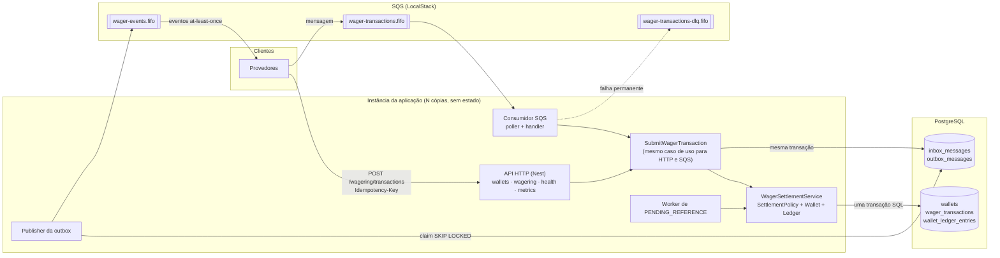
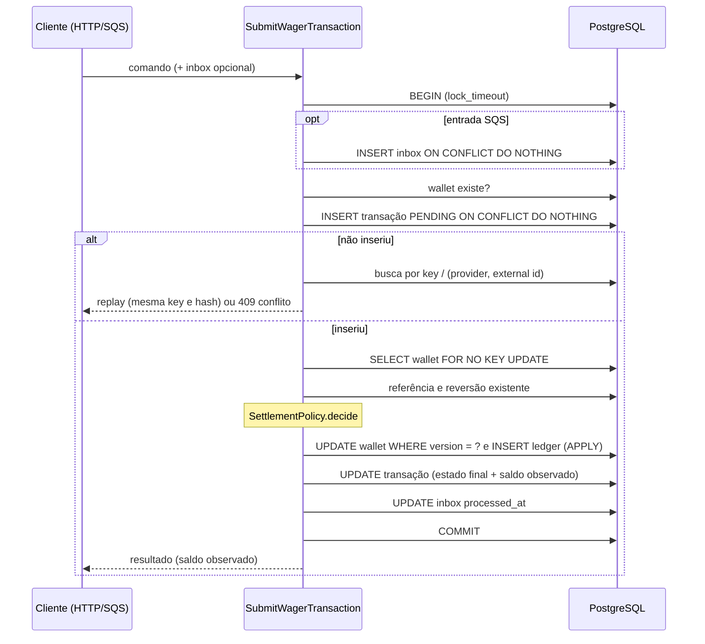
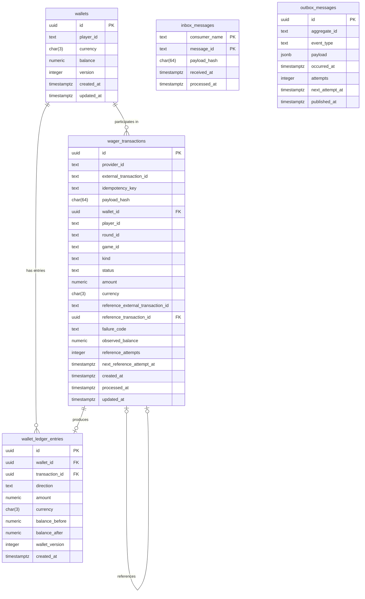

# Arquitetura — Distributed Wagering Processor

## Visão Geral

Serviço financeiro distribuído que processa transações de apostas (`BET`, `WIN`, `LOSS`, `REFUND`, `ROLLBACK`) de múltiplos provedores por **HTTP** e por **SQS**, mantendo o saldo de cada wallet consistente com um **ledger imutável**. O sistema permanece correto com mensagens duplicadas, fora de ordem, processadas simultaneamente por várias instâncias, e com quedas de processo em qualquer ponto.

Três ideias sustentam o desenho:

1. **O banco é o árbitro.** Unicidade (idempotência, uma wallet por jogador/moeda, uma reversão por transação), imutabilidade (ledger e transações terminais) e não-negatividade do saldo são `UNIQUE`, `CHECK` e *triggers* do PostgreSQL. O código de aplicação as respeita, mas não é a única barreira (ADR 7).
2. **Uma transação SQL por efeito financeiro.** Inbox, transação, saldo, ledger e outbox são confirmados juntos ou não são (ADR 16, 17, 24). Nada é publicado antes do commit: a publicação é um processo à parte que lê a outbox já confirmada (ADR 23).
3. **A unidade de concorrência é a wallet.** Lock pessimista por linha (`FOR NO KEY UPDATE`), com a versão e o `CHECK` como guardas adicionais. Não existe lock global, e instâncias distintas coordenam-se apenas pelo PostgreSQL (ADR 16).

### Componentes

Fluxo de uma aposta: a requisição (HTTP ou mensagem) chega ao caso de uso; dentro de **uma** transação ele grava a inbox (SQS), insere a transação de forma idempotente, trava a wallet, decide, altera o saldo, acrescenta o lançamento ao ledger, atualiza o estado final e enfileira os eventos na outbox. Só depois do commit a mensagem SQS é confirmada (`ack`) e o publisher entrega os eventos ao `wager-events.fifo`. O diagrama de sequência está no ADR 16.

Camadas por módulo (`wallet`, `wagering`, `messaging`, `shared`): `domain` (puro, sem Nest nem ORM) → `application` (casos de uso e portas `*.port.ts`) → `infrastructure` (MikroORM, SQS, workers) e `presentation` (controllers, validação, filtro de erros). O domínio é construído por *factories* estáticas (`create`, `from`, `rehydrate`) e expõe o estado por getters; a reidratação não revalida transições (ADR 1).

### Onde encontrar cada tema

| Tema | Onde |
|---|---|
| Modelo de dados (ER) e garantia ⇒ mecanismo no schema | ADR 7; [Modelo de Dados](#modelo-de-dados-diagrama-er) e [Mapeamento](#mapeamento-garantia-contábilconcorrência--mecanismo-no-schema) |
| Concorrência, alternativas e trade-offs | ADR 16 (itens 3–5) e [Estratégia de concorrência](#estratégia-de-concorrência-e-trade-offs) |
| Idempotência e algoritmo do `payloadHash` | ADR 6 (item 4), ADR 16 e [Idempotência](#idempotência-em-resumo) |
| Máquina de estados | ADR 6 (item 1) |
| Taxonomia de `FailureCode` e ação ao provedor | ADR 6 (item 2) |
| Mapeamento HTTP | ADR 18 (item 4) |
| Inbox, outbox, DLQ e garantias (*at-least-once*, dedup, ordem) | ADR 10, 11, 23, 24 e [Garantias de mensageria](#garantias-de-mensageria) |
| `PENDING_REFERENCE`: parâmetros e justificativa | ADR 25 |
| Observabilidade (campos de log, métricas, health) | ADR 12, 26 |
| Autenticação (não implementada: desenho e ponto de extensão) | ADR 13 |
| Testes com processos reais e falhas injetadas | ADR 22, 27 |
| Interpretações adotadas | [Interpretações adotadas](#interpretações-adotadas) |
| Rastreabilidade (§5 e §14 do enunciado ⇒ código ⇒ teste) | [Rastreabilidade](#rastreabilidade-restrições-invioláveis-e-falhas-eliminatórias) |
| Limitações e próximos passos | [Limitações conhecidas](#limitações-conhecidas-e-o-que-seria-feito-com-mais-tempo) |

## Decisões (ADRs)

### ADR 1: Uso do MikroORM com EntitySchema

- **Contexto:** Necessidade de manter o domínio desacoplado de detalhes de banco de dados e ORMs.
- **Decisão:** Utilizar MikroORM com definição via `EntitySchema` e mappers manuais.
- **Consequências:** Isolamento completo do domínio em relação à persistência.

### ADR 2: Injeção de Dependência Explícita

- **Contexto:** O NestJS depende nativamente de reflexão (`emitDecoratorMetadata`), que pode conflitar com certas restrições do Bun ou arquiteturas puras.
- **Decisão:** Uso estrito de tokens explícitos (`@Inject(TOKEN)`).

### ADR 3: Emulador SQS via LocalStack

- **Contexto:** Necessidade de testar mensageria SQS FIFO localmente sem dependência de nuvem real.
- **Decisão:** Uso do LocalStack para SQS.

### ADR 4: Value Object Money com escala fixa e ausência de arredondamento

- **Contexto:** Cálculos financeiros sujeitos a erros de ponto flutuante binário (`number`) e inconsistências de arredondamento implícito violam a correção contábil do sistema.
- **Decisão:** Criamos o Value Object imutável `Money` utilizando uma instância isolada de `decimal.js` configurada sem arredondamentos implícitos (`ROUND_DOWN`, precisão 28). Nenhuma operação produz mais de 2 casas decimais. `Money.from` valida formato estrito `^-?(0|[1-9]\d{0,16})\.\d{2}$` (rejeitando `-0.00`, espaços, zeros à esquerda e notação científica), enquanto `Money.fromContract` rejeita estritamente valores negativos para entradas de borda (HTTP/SQS).
- **Consequências:** Garantia absoluta de precisão aritmética (`0.10 + 0.20 = 0.30`), imutabilidade estrutural e rejeição em tempo de execução de qualquer representação monetária ambígua.

### ADR 5: Versão da Wallet no Ledger (`walletVersion`) e integridade contábil

- **Contexto:** Toda alteração de saldo da `Wallet` precisa ser estritamente correlacionada a um lançamento de auditoria imutável, permitindo ordenação, concorrência e chave única para consistência.
- **Decisão:** Incluir `walletVersion: number` em `WalletLedgerEntry` representando a versão da carteira resultante da movimentação (`UNIQUE(wallet_id, wallet_version)`). O agregado `Wallet` incrementa sua versão estritamente quando o saldo muda (`debit` e `credit`) e emite o lançamento de ledger correspondente no mesmo ato. A factory `WalletLedgerEntry.create` verifica a igualdade estrita `balanceBefore ± money === balanceAfter`.
- **Consequências:** Impossibilidade de desvio entre o saldo da carteira e o histórico do ledger. Caso ocorra erro de saldo insuficiente (`InsufficientFundsError`), a carteira mantém seu estado original intocado.

### ADR 6: Máquina de estados de WagerTransaction, Política de Liquidação e Hash Canônico

- **Contexto:** Transações de apostas (`BET`, `WIN`, `LOSS`, `REFUND`, `ROLLBACK`) requerem controle financeiro estrito, auditoria imutável de transições, resolução assíncrona de referências fora de ordem e deduplicação idempotente sem colisão de payloads.
- **Decisão:**
  1. **Máquina de Estados de `WagerTransaction`:**
     - Estados: `PENDING`, `PENDING_REFERENCE`, `PROCESSED`, `REJECTED`, `FAILED`.
     - Estados terminais imutáveis: `PROCESSED`, `REJECTED`, `FAILED`. Qualquer transição a partir de um estado terminal ou transição inválida lança `InvalidTransactionStateError`.
     - Tabela de transições válidas:
       | Estado Inicial | Evento / Método | Estado Destino | Condições |
       |---|---|---|---|
       | `(novo)` | `create(props)` | `PENDING` | REFUND/ROLLBACK exigem referência externa; money > 0 (LOSS >= 0) |
       | `PENDING` | `markProcessed(...)` | `PROCESSED` | Sucesso financeiro; grava `observedBalance` |
       | `PENDING` | `markPendingReference(...)`| `PENDING_REFERENCE` | Referência ausente ou ainda em processamento |
       | `PENDING` | `reject(code, ...)` | `REJECTED` | Rejeição de negócio; grava `observedBalance` |
       | `PENDING` | `fail(code)` | `FAILED` | Erro permanente de infraestrutura |
       | `PENDING_REFERENCE` | `scheduleReferenceRetry(...)` | `PENDING_REFERENCE` | Incrementa `referenceAttempts` e agenda nova data |
       | `PENDING_REFERENCE` | `markProcessed(...)` | `PROCESSED` | Referência processada com sucesso |
       | `PENDING_REFERENCE` | `reject(code, ...)` | `REJECTED` | Violação de regra ou tentativas esgotadas (`REFERENCE_NOT_FOUND`) |
       | `PENDING_REFERENCE` | `fail(code)` | `FAILED` | Erro permanente de infraestrutura |

  2. **Taxonomia de Códigos de Falha (`FailureCode`) e Ação Recomendada ao Provedor:**
     | FailureCode | Significado | Ação Sugerida ao Provedor |
     |---|---|---|
     | `INSUFFICIENT_FUNDS` | Saldo insuficiente para efetuar `BET` | Não reenviar; aguardar depósito do jogador |
     | `REVERSAL_WOULD_OVERDRAW` | Reversão (débito) deixaria saldo da carteira negativo | Intervenção manual / conciliação financeira |
     | `REFERENCE_NOT_FOUND` | Transação referenciada não encontrada após limite de retries | Reenviar após verificar status da transação de origem |
     | `REFERENCE_MISMATCH` | Inconsistência de player, wallet, moeda ou rodada com a referência | Corrigir payload da requisição antes de reenviar |
     | `REFERENCE_NOT_PROCESSED` | Transação de referência terminou em `REJECTED` ou `FAILED` | Não reenviar; transação de origem não possui efeito financeiro |
     | `INVALID_REFERENCE_KIND` | Tipo de operação referenciada incompatível com o tipo da reversão | Corrigir payload da requisição (verificar tipo da referência) |
     | `REFERENCE_AMOUNT_MISMATCH` | Valor do REFUND/ROLLBACK diferente do valor exato da referência | Corrigir payload com o valor exato da transação original |
     | `ALREADY_REVERSED` | Transação de referência já foi revertida anteriormente | Não reenviar; reversão já consumida |
     | `CURRENCY_MISMATCH` | Moeda da operação difere da moeda contratada da carteira | Corrigir payload com a moeda correspondente à carteira |
     | `PLAYER_WALLET_MISMATCH` | `playerId` informado na operação não é o proprietário da wallet | Corrigir payload associando o jogador correto |
     | `PERMANENT_INFRASTRUCTURE_ERROR` | Falha terminal de infraestrutura sem possibilidade de auto-recuperação | Intervenção manual da equipe de engenharia |

  3. **Interpretações Adotadas na Liquidação (`SettlementPolicy`):**
     - `WIN` e `LOSS` com referência opcional: Quando fornecida, a referência deve obrigatoriamente apontar para uma `BET` da mesma rodada, carteira e jogador.
     - Reversão única: Uma transação referenciada só pode ser revertida uma única vez (`existingReversal` bloqueia qualquer tentativa subsequente).
     - Referência pendente: Se a transação referenciada estiver `PENDING` ou `PENDING_REFERENCE`, a dependente entra/permanece em `PENDING_REFERENCE`.
     - Pureza: `SettlementPolicy` é puramente funcional e não aplica mutações em entidades ou agregados.

  4. **Algoritmo do `payloadHash`:**
     - Baseado em SHA-256 hex sobre representação canônica recursiva (`canonicalJson`).
     - Chaves de objetos são ordenadas lexicograficamente de forma recursiva; delimitadores sem espaços (`{"a":1,"b":2}`).
     - Propriedades com valor `null` ou `undefined` são estritamente omitidas.
     - Objetos monetários `Money` são canonicamente representados por `{ "amount": "xx.xx", "currency": "YYY" }`.
     - Campos participantes: `providerId`, `externalTransactionId`, `playerId`, `walletId`, `roundId`, `gameId`, `kind`, `money`, `referenceExternalTransactionId` (quando presente).
     - Metadados de transporte (`Idempotency-Key`, `messageId`, headers HTTP, timestamps de fila) são excluídos do hash.
- **Consequências:** Integridade semântica determinística, auditoria inequívoca de transições e idempotência estrita independentemente do canal de ingestão (HTTP vs SQS).

### ADR 7: Schema do Banco de Dados, Constraints e Garantias Estruturais de Auditoria

- **Contexto:** Em sistemas de liquidação financeira distribuída (README §5.9), regras de negócio e integridade monetária não podem residir exclusivamente no código de aplicação. O banco de dados PostgreSQL deve ser o guardião definitivo contra concorrência destrutiva, duplicações de crédito/débito, race conditions e violações de auditoria contábil.
- **Decisão:**
  1. **Tabelas e Restrições Estruturais:**
     - `wallets`: Unicidade garantida por `UNIQUE(player_id, currency)`. Não-negatividade imposta por `CHECK(balance >= 0)`. Concorrência otimista resguardada por `CHECK(version >= 1)` e formato ISO por `CHECK(currency ~ '^[A-Z]{3}$')`.
     - `wager_transactions`: Idempotência garantida duplamente por `UNIQUE(idempotency_key)` e `UNIQUE(provider_id, external_transaction_id)`. Coerência de estados assegurada por constraints estritas (`CHECK failure_code` coerente com `REJECTED`/`FAILED`; `CHECK processed_at` coerente com `PROCESSED`; `CHECK reference_external_transaction_id` obrigatório para `REFUND`/`ROLLBACK`).
     - **Reversão Única:** Protegida no schema através de índice único parcial:
       `CREATE UNIQUE INDEX uq_idx_wager_transactions_processed_reversal ON wager_transactions (reference_transaction_id) WHERE status = 'PROCESSED' AND kind IN ('REFUND', 'ROLLBACK');`
     - **Políticas de Imutabilidade e Auditoria em `wager_transactions`:** Triggers PL/pgSQL bloqueiam qualquer mutação (`UPDATE`) sobre transações em estados terminais (`PROCESSED`, `REJECTED`, `FAILED`), proíbem modificação de colunas imutáveis/identidade (`provider_id`, `wallet_id`, `kind`, `amount`, etc.), e proíbem terminantemente `DELETE` de transações.
     - `wallet_ledger_entries`: Livro-razão estritamente **append-only**. Constraints verificam a aritmética exata de cada linha (`DEBIT` exige `balance_after = balance_before - amount`; `CREDIT` exige `balance_after = balance_before + amount`). Chave `UNIQUE(transaction_id, wallet_id)` assegura no máximo um lançamento por carteira por transação financeira. Chave `UNIQUE(wallet_id, wallet_version)` previne forks contábeis. Triggers `BEFORE UPDATE OR DELETE` (row-level) e `BEFORE TRUNCATE` (statement-level) impedem mutação, exclusão ou truncamento acidental.
     - `inbox_messages`: Chave primária composta `PRIMARY KEY (consumer_name, message_id)` impede duplicidade de ingestão e viabiliza redelivery idempotente.
     - `outbox_messages`: Índice parcial `(COALESCE(next_attempt_at, occurred_at)) WHERE published_at IS NULL` otimiza o claim concorrente de eventos pendentes para publicação com `SKIP LOCKED`.
  2. **Avaliação do Constraint Trigger Deferrable para Saldo da Wallet:**
     - A constraint trigger opcional diferida (`DEFERRABLE INITIALLY DEFERRED`) que validaria `wallets.balance = last ledger balance_after` no momento do commit foi avaliada. Em cenários de alta concorrência em hot wallets e pipelines transacionais que manipulam operações sem efeito no saldo (como `LOSS` ou rejeições que registram auditoria sem criar lançamento contábil), esse trigger impõe lock adicional e acoplamento desnecessário, uma vez que a invariante contábil já é resguardada deterministicamente pelo Unit of Work da aplicação (`Wallet` aggregate + `wallet_ledger_entries`), pelo optimistic locking (`version`) e pelas constraints de não-negatividade e unicidade de versão (`UNIQUE(wallet_id, wallet_version)`). Optou-se por não aplicá-la no schema para resguardar a latência e o throughput de hot wallets.
- **Consequências:** Impossibilidade de corrupção de saldo, lost updates ou adulteração contábil mesmo sob falha catastrófica de código ou acesso concorrente direto ao banco.

### ADR 8: Estratégia de Persistência com MikroORM, Unit of Work Transacional e SQL Cru nos Caminhos Críticos

- **Contexto:**
  O sistema exige garantias financeiras rigorosas sob concorrência intensa: row locking em wallets com timeout configurável, garantias estritas de atomicidade entre inbox, wallet, ledger, transação e outbox, além de ausência absoluta de vazamento do ORM para o domínio de negócio.
- **Decisão:**
  1. **MikroORM desacoplado via EntitySchema e Mappers:**
     - O domínio permanece 100% puro, sem anotações ou herança de classes do ORM ou do NestJS.
     - A persistência relacional é mapeada por `EntitySchema` independentes (`WalletEntitySchema`, `WagerTransactionEntitySchema`, `WalletLedgerEntryEntitySchema`).
     - Todas as colunas monetárias `numeric(19,2)` são mapeadas explicitamente como `string` para eliminar risco de conversão implícita para IEEE-754 `number`.
     - Mappers estáticos explícitos realizam a conversão bidirecional entre linhas de persistência e entidades do domínio utilizando `Money.from({ amount, currency })` e as fábricas `rehydrate`.
  2. **Unit of Work e Contexto Assíncrono com AsyncLocalStorage:**
     - Cada execução `unitOfWork.run(fn)` cria um novo fork isolado de `EntityManager` (`em.fork()`), garantindo identity map limpo sem estado residual entre execuções concorrentes.
     - A transação é aberta via `em.transactional` com isolamento `READ COMMITTED`.
     - O `EntityManager` transacional ativo é mantido em `AsyncLocalStorage`. Chamadas aninhadas a `run` dentro do mesmo contexto assíncrono detectam a transação ativa e a reutilizam de forma transparente.
     - Timeout de aquisição de lock (`SET LOCAL lock_timeout = '...ms'`) é configurado automaticamente na abertura de cada transação (usando `DB_LOCK_TIMEOUT_MS`).
     - Callbacks de pós-commit (`afterCommit(fn)`) são disparados exclusivamente após o commit bem-sucedido da transação raiz.
  3. **SQL Cru nos Caminhos Críticos de Concorrência e Auditoria:**
     - As operações de alta semântica contábil e de concorrência (`SELECT ... FOR NO KEY UPDATE` na wallet, `INSERT ... ON CONFLICT DO NOTHING`, `UPDATE ... WHERE version = ?`, `INSERT` imutável no ledger) são executadas através de SQL cru parametrizado (`em.execute`) sobre a conexão transacional ativa, evitando o mecanismo automático de dirty checking (`persist/flush`) do ORM nesses caminhos sensíveis.
     - A interface `LedgerRepository` expõe unicamente o método `append(entry)`. Não existem métodos de alteração (`update`) ou exclusão (`delete`), em perfeita consonância com as triggers do banco.
  4. **Classificação e Normalização de Erros do PostgreSQL:**
     - Erros de lock timeout (`55P03`) são convertidos em `LockTimeoutError` (transitório).
     - Deadlocks (`40P01`), falhas de serialização (`40001`) e desconexões/falhas de rede são convertidos em `TransientInfrastructureError`.
     - Conflitos de concorrência otimista (`updateBalance` afetando 0 linhas) lançam `WalletVersionConflictError` (transitório).
     - Violações de unicidade (`23505`) são mapeadas para `UniqueConstraintViolationError`, expondo a constraint violada.
- **Consequências:**
  Concorrência segura e previsível sem starvation nem locks eternos, total desacoplamento arquitetural entre regras contábeis e biblioteca de persistência, e tratamento transparente de retries transitórios em camadas superiores.

### ADR 9: Eventos de Integração, `eventId` Determinístico e `aggregateId = walletId`

- **Contexto:** O serviço publica eventos de integração via Transactional Outbox para consumidores externos. A publicação é *at-least-once*: o mesmo evento pode chegar mais de uma vez (redelivery, publisher que morre após enviar e antes de marcar como publicado, reexecução do fluxo). O payload precisa ser JSON estável e versionável, sem tipos monetários ambíguos.
- **Decisão:**
  1. **Envelope:** `IntegrationEvent<T>` é uma classe abstrata (`src/messaging/domain/`). Cada evento é uma subclasse com `eventType` e `version = 1` no tipo e uma factory `static from(...)` que recebe um `EventContext { correlationId, causationId?, now }`. `toJSON()` serializa `occurredAt` em ISO-8601 e omite `causationId` quando ausente. `data` carrega `MoneyProps` (string decimal com 2 casas), nunca `Money` nem `number`.
  2. **Eventos mínimos:**
     | Evento | Quando é emitido | Campos de `data` |
     |---|---|---|
     | `WagerTransactionProcessed` | Qualquer transação aplicada (`PROCESSED`), inclusive `LOSS` e `OPENING` | dados da transação, `referenceTransactionId?`, `observedBalance`, `processedAt` |
     | `WagerTransactionRejected` | Transação rejeitada por regra de negócio (`REJECTED`) | dados da transação, `failureCode`, `observedBalance?` |
     | `WalletBalanceChanged` | **Somente** quando o saldo muda (há lançamento no ledger) | `walletId`, `transactionId`, `direction`, `money`, `balanceBefore`, `balanceAfter`, `walletVersion` |
     | `WagerTransactionPendingReference` | Referência ausente ou ainda não finalizada (`PENDING_REFERENCE`) | dados da transação, `referenceExternalTransactionId` |

     "Dados da transação" = `transactionId`, `walletId`, `playerId`, `providerId`, `externalTransactionId`, `roundId`, `gameId`, `kind`, `money`. As factories lançam `InvalidIntegrationEventError` se a transação não estiver no estado esperado, evitando emitir um evento que não corresponde ao fato.
  3. **`eventId` determinístico:** UUID v5 sobre `"{transactionId}:{eventType}"` com namespace fixo do projeto (`EVENT_ID_NAMESPACE`, que nunca deve mudar). A mesma transação jamais produz dois eventos do mesmo tipo com ids diferentes. Reexecuções do fluxo geram o mesmo id e o `ON CONFLICT DO NOTHING` do outbox descarta a duplicata; no broker o id é o `MessageDeduplicationId`, e o consumidor o usa para deduplicar. Uma transação emite cada tipo no máximo uma vez, o que casa com `UNIQUE(transaction_id, wallet_id)` no ledger (no máximo um `WalletBalanceChanged` por transação).
  4. **`aggregateId = walletId`** em todos os eventos. É o `MessageGroupId` do FIFO: eventos da mesma wallet são ordenados entre si no broker; wallets distintas progridem em paralelo.
- **Consequências:** Eventos reaplicáveis sem efeito colateral e payload auditável e versionável. Para mudar o formato de um evento, incrementa-se `version` (o tipo e a versão andam juntos).

### ADR 10: Outbox e Inbox (domínio)

- **Contexto:** O evento confirmado não pode ser perdido nem publicado antes do commit (README §5.4), e o consumo SQS precisa de deduplicação persistente.
- **Decisão:**
  1. **`OutboxMessage`:** nasce de `enqueue(event)` com `id = eventId` e `payload = event.toJSON()`. `isDue(now)` usa a mesma expressão do índice de claim, `COALESCE(nextAttemptAt, occurredAt) <= now`. `scheduleRetry(now, policy)` incrementa `attempts` e agenda com backoff exponencial `min(60s, 1s * 2^(n-1))`, **sem jitter** para manter os testes determinísticos; a política é injetável. **Não há limite de tentativas**: um evento já confirmado não pode ser descartado, então a falha persistente aparece como defasagem (`outbox_lag_seconds`, prompt 11), não como perda. Publicar ou reagendar uma mensagem já publicada lança `InvalidMessageStateError`.
  2. **`InboxMessage`:** identidade `(consumerName, messageId)` com `payloadHash` (SHA-256 hex) para detectar o mesmo `messageId` reentregue com conteúdo diferente. `markProcessed` só uma vez.
- **Consequências:** O reagendamento é puro e testável sem relógio real. Detalhes dos repositórios (claim com `SKIP LOCKED`) ficam no ADR 11.

### ADR 11: Repositórios de Inbox e Outbox, Claim com `SKIP LOCKED` e Limite de Ordenação

- **Contexto:** Vários publishers (e várias instâncias) leem a mesma outbox; o consumo SQS é *at-least-once*. Inbox e outbox precisam participar da transação financeira.
- **Decisão:**
  1. **Transação obrigatória:** `OutboxRepository` e `InboxRepository` usam sempre o `EntityManager` da transação corrente e falham se não houver `UnitOfWork.run`. Diferente dos demais repositórios, não há fallback para o EntityManager raiz: em autocommit, o lock do claim seria solto na hora e o `enqueue` ficaria fora da transação financeira.
  2. **Outbox:** `enqueue` usa `INSERT … ON CONFLICT (id) DO NOTHING` (o `id` é o `eventId` determinístico). `claimDue(now, limit)` seleciona `published_at IS NULL AND COALESCE(next_attempt_at, occurred_at) <= now`, ordena por `COALESCE(next_attempt_at, occurred_at), id` e usa `FOR UPDATE SKIP LOCKED`, casando com o índice parcial `idx_outbox_messages_claim`. Dois publishers simultâneos recebem conjuntos disjuntos, sem esperar um pelo outro. O lock vale até o fim da transação: se o publisher morrer antes do commit, as linhas voltam a ficar disponíveis para outra instância.
  3. **Inbox:** `tryReceive` usa `ON CONFLICT (consumer_name, message_id) DO NOTHING` e devolve `false` na redelivery. Se o processamento falhar e a transação der rollback, o registro da inbox some junto e a mensagem reentregue é processada de novo.
  4. **Timestamps:** `em.execute` (SQL cru) devolve `timestamptz` como string; os mappers de messaging normalizam com `toDate`/`toOptionalDate`.
  5. **Limitação de ordenação:** a ordem de publicação só é garantida por wallet quando há um único publisher ativo por vez. Com vários publishers, o evento de `walletVersion` N+1 pode ser publicado antes do N (cada publisher reclama um subconjunto e a publicação em si é concorrente). O FIFO ordena apenas o que chega ao broker. **O consumidor ordena e descarta duplicatas por `walletVersion`** (`WalletBalanceChanged`), não pela ordem de chegada. Não se usa lock global para forçar ordem (README §5.6).
- **Consequências:** Publicação concorrente sem perda e sem duplicação indefinida (a duplicata eventual é absorvida pelo `eventId`). O custo é a ordenação best-effort no broker, compensada pelo versionamento no consumidor.

### ADR 12: Observabilidade — contexto de execução, logs estruturados e métricas

- **Contexto:** README §12 exige logs JSON com identificadores de correlação, sem dados sensíveis, e métricas de negócio. Todos os use cases seguintes precisam instrumentar o que implementam sem reinventar a infraestrutura.
- **Decisão:**
  1. **Contexto de execução (`AsyncLocalStorage`):** `runWithContext(ctx, fn)` abre o contexto (copiando o objeto) e `bindContext(partial)` o enriquece com `messageId`, `transactionId`, `walletId`, `providerId`; valores `undefined` não apagam o que já foi vinculado. O contexto é compartilhado por toda a execução; ramos de um `Promise.all` que precisem de ids próprios abrem um `runWithContext` aninhado. O middleware HTTP reaproveita `X-Correlation-Id` quando casa `^[A-Za-z0-9._:-]{1,128}$` (evita injeção em log/cabeçalho), gera UUID v7 caso contrário e devolve o header na resposta.
  2. **Logs (`pino`, JSON):** `AppLogger` mescla o contexto corrente em cada linha via `mixin` e substitui o logger do Nest (`app.useLogger`, com `bufferLogs`). Campos fixos: `time` (ISO), `level` (texto), `msg`, `correlationId`, `messageId`, `transactionId`, `walletId`, `providerId` (os de contexto aparecem quando vinculados). **Política: não se logam valores monetários nem payloads completos; logam-se identificadores e resultados (`status`, `failureCode`).** Como rede de segurança, `redactSensitive` troca por `[Redacted]` as chaves `authorization`, `cookie`, `amount`, `money`, `payload` e qualquer chave que contenha `balance`, em qualquer profundidade e sem distinguir maiúsculas. Optou-se por essa função em vez do `redact` nativo do pino porque os caminhos do `fast-redact` não aceitam curingas no meio do nome (`*.balance*`) nem profundidade arbitrária. O log de acesso HTTP (interceptor) registra método, padrão da rota (`/wallets/:id`, não o path real), status e duração no evento `finish` da resposta, sem corpo, query string nem cabeçalhos; `/metrics` sai em `debug` para não poluir o log com o scrape.
  3. **Métricas (`prom-client`):** `MetricsService` é o único ponto de instrumentação. Declara todos os instrumentos num `Registry` próprio (não o global), expõe métodos tipados (`recordTransaction`, `recordDuplicate`, `startProcessingTimer`…) e os módulos seguintes apenas os chamam. Rótulos têm valores fechados e baixa cardinalidade: nunca `walletId`, `transactionId` nem valores monetários. `GET /metrics` é aberto (README §2) e as métricas padrão do processo (`collectDefaultMetrics`) funcionam no Bun.

     | Métrica | Tipo | Rótulos | Quem alimenta |
     |---|---|---|---|
     | `wager_transactions_total` | counter | `kind`, `status`, `failure_code` (`NONE` sem falha) | use cases de processamento |
     | `wager_duplicates_total` | counter | `source` (`http`/`sqs`/`pending_worker`), `type` (`replay`/`conflict`) | idempotência |
     | `wager_retries_total` | counter | `source`, `reason` (`transient_failure`/`pending_reference`/`redelivery`) | consumidor SQS, worker de referência |
     | `sqs_dlq_messages_total` | counter | `reason` (`invalid_message`/`max_receive_count`/`permanent_failure`) | consumidor SQS |
     | `wallet_lock_conflicts_total` | counter | `type` (`lock_timeout`/`version_conflict`/`deadlock`) | classificação de erros do banco |
     | `outbox_lag_seconds` | gauge | — | publisher da outbox (idade do evento pendente mais antigo; 0 se vazia) |
     | `outbox_published_total` | counter | — | publisher da outbox |
     | `outbox_publish_failures_total` | counter | — | publisher da outbox |
     | `wager_processing_duration_seconds` | histogram | `source`, `outcome` | use cases de processamento |
     | `reconciliation_divergences_total` | counter | — | reconciliação |

- **Consequências:** Cada prompt seguinte instrumenta o que implementa sem tocar na infraestrutura. O custo é que adicionar uma métrica exige editar `MetricsService`, o que mantém o catálogo e os rótulos num lugar só. Ficam fora de escopo health checks (prompt 14) e OpenTelemetry. Limitação: o contexto é por processo; a correlação entre serviços depende de o chamador enviar `X-Correlation-Id`.

### ADR 13: Autenticação não implementada, com ponto de extensão explícito

- **Contexto:** README §2 não atribui pontos à autenticação e aceita não implementá-la, desde que a decisão seja documentada, o desenho alternativo seja descrito e o ponto de extensão fique explícito no código. Health checks e `/metrics` ficam abertos; mensagens da fila são canal interno confiável.
- **Decisão:**
  1. **Nada de autenticação artesanal.** `AuthGuard` global (`APP_GUARD`) é **no-op**: sempre permite. Ele já lê a marca `@Public()` (`Reflector`), de modo que trocar o corpo pelo guard real não exige tocar nas rotas. `/metrics` está marcada `@Public()`; os health checks seguirão a mesma regra.
  2. **`ProviderIdentityPort`** (`resolve(request): Promise<ProviderIdentity | undefined>`, token `PROVIDER_IDENTITY_TOKEN`) isola a origem da identidade do provedor. A implementação atual, `NoopProviderIdentity`, nunca resolve identidade.
  3. **Desenho adotado quando houver autenticação:** integrar um IdP externo via OIDC (Keycloak ou Zitadel no Docker Compose), sem tabela própria de usuários. O guard real valida o token (assinatura por JWKS, expiração, audiência) através da porta e **exige que o `providerId` do token seja igual ao `providerId` do corpo**, para que um provedor não submeta transações em nome de outro; falha de token ⇒ 401, divergência ⇒ 403. O canal SQS continua confiável, mas a identidade do provedor na mensagem segue sujeita às validações de domínio.
- **Consequências:** O custo de ligar a autenticação é implementar uma classe (guard) e uma implementação da porta. Enquanto isso, qualquer cliente que alcance a API pode submeter transações em nome de qualquer provedor; a API não deve ser exposta fora de rede confiável nesta configuração.

### ADR 14: Camada HTTP compartilhada — validação, contrato de dinheiro e envelope de erro

- **Contexto:** Todos os endpoints precisam validar a entrada do mesmo jeito, nunca aceitar dinheiro fora do contrato e responder falhas com um envelope único, sem vazar detalhes internos.
- **Decisão:**
  1. **Validação com zod** (`ZodValidationPipe`): devolve a *saída* do schema (por exemplo `Money`) e, em falha, lança `RequestValidationError` com uma entrada `{ path, message }` por campo. O erro vive na apresentação, não no domínio.
  2. **`MoneyPropsSchema`** só confere os tipos (`amount` e `currency` string) e delega o formato a `Money.fromContract`, repassando a mensagem do domínio. A regra de dinheiro continua em um lugar só; o shape `number` nunca chega ao domínio.
  3. **`AllExceptionsFilter`** (`APP_FILTER`) aplica o envelope `{ error: { code, message, details? }, correlationId }`: `RequestValidationError` e erros 4xx do framework (JSON malformado, corpo grande) ⇒ 400/4xx (`VALIDATION_ERROR` para 400, mensagem do parser omitida); `DomainError` ⇒ status da tabela `DOMAIN_ERROR_HTTP_STATUS` (`WALLET_ALREADY_EXISTS` 409, `WALLET_NOT_FOUND`/`TRANSACTION_NOT_FOUND` 404; os códigos de idempotência entram na tabela no prompt 09); `TransientInfrastructureError` ⇒ 503 `TRANSIENT_FAILURE` com `Retry-After`; o resto ⇒ 500 `INTERNAL_ERROR` genérico, com a causa somente no log.
  4. **`DomainError` fora da tabela vira 500**, não 4xx: um código sem mapeamento indica falha de programação ou invariante violada, não erro do cliente. A mensagem original não é exposta.
  5. **`correlationId` sempre presente.** Vem do contexto de execução; falhas do body-parser ocorrem antes do middleware de correlação, então o filtro gera um id novo e o devolve também no header `X-Correlation-Id`.
  6. **Log do 500 sem SQL.** A mensagem de `InfrastructureError` carrega o SQL com seus parâmetros (inclusive valores monetários), então o filtro loga dele só o nome, o código e os frames da pilha; a política de não logar valores (ADR 12) vale também para falhas inesperadas.
- **Consequências:** Cada endpoint novo só declara schema e códigos de erro. O custo é manter `DOMAIN_ERROR_HTTP_STATUS` sincronizada com os erros de domínio: um erro novo esquecido na tabela aparece como 500, o que os testes de cada endpoint pegam.

### ADR 15: Criação de wallet e a transação interna `OPENING`

- **Contexto:** Toda alteração de saldo precisa de lançamento no ledger (README §6.2), e o ledger referencia uma transação por FK. Uma wallet que nasce com saldo inicial maior que zero seria um saldo sem lançamento correspondente, quebrando a invariante `saldo = soma do ledger` desde o primeiro instante.
- **Decisão:**
  1. **Tudo em um único `UnitOfWork.run`**, na ordem imposta pelas FKs: `wallets` → `wager_transactions` → `wallet_ledger_entries` → `outbox_messages`. Qualquer falha reverte o conjunto (testado com falha injetada no `LedgerRepository`).
  2. **Duplicata** `(playerId, currency)`: `insertIfAbsent` (`ON CONFLICT DO NOTHING`) devolve `false` ⇒ `WalletAlreadyExistsError` (409). Sob concorrência a unicidade vem do schema (`uq_wallets_player_currency`), não de checagem prévia: 10 criações simultâneas resultam em 1 wallet e 9 erros.
  3. **Identidade interna do `OPENING`:** `providerId = "internal"`, `externalTransactionId = idempotencyKey = "opening:{walletId}"`, `roundId = gameId = "opening"`. É determinística por wallet, não colide com provedores reais e as unicidades de idempotência do schema valem para ela também. A API e a fila nunca aceitam `OPENING` (README §6.3). O `payloadHash` é calculado como nas demais transações.
  4. **Nasce `PROCESSED`**, inserida já no estado final (`markProcessed` antes do `INSERT`), com `observedBalance` igual ao saldo inicial. Não passa por `PENDING`, pois não há nada a esperar e o trigger de imutabilidade do schema trata `UPDATE` de estado terminal como erro.
  5. **Lançamento `CREDIT`** com `balanceBefore = 0.00`, `balanceAfter = saldo inicial` e `walletVersion = 1`. É montado diretamente, sem `Wallet.credit`, porque este incrementaria a versão: a wallet já nasce na versão 1 com o saldo inicial.
  6. **Eventos:** `WagerTransactionProcessed` e `WalletBalanceChanged` (`aggregateId = walletId`, `eventId` determinístico por transação e tipo) entram na outbox na mesma transação, pois o saldo mudou de 0 para o inicial.
  7. **Saldo inicial zero:** só a wallet, na versão 1; sem transação, lançamento nem evento, já que nenhum saldo mudou. O primeiro crédito real terá `walletVersion = 2`; por isso a invariante dos testes (`assertLedgerMatchesBalance`) compara `wallet.version` com a maior versão do ledger e aceita ledger vazio apenas com saldo 0.00 e versão 1.
  8. **Observabilidade:** um log `wallet created` por criação (ids e moeda, sem valores) e `wager_transactions_total{kind="OPENING",status="PROCESSED"}`, ambos depois do commit.
- **Consequências:** A invariante saldo = soma do ledger vale desde a criação, e quem audita ou reconcilia não precisa tratar wallets nascidas com saldo como caso especial. O custo é uma transação e um par de eventos a mais por criação com saldo; consumidores devem aceitar `kind = OPENING` e `providerId = "internal"` nos eventos.

### ADR 16: SubmitWagerTransaction — idempotência persistente e concorrência por wallet

- **Contexto:** O caso de uso é compartilhado por HTTP e SQS e concentra as restrições mais pesadas (README §5, §8): nenhuma instância pode confiar em memória, duas apostas simultâneas não podem gastar o mesmo saldo e uma repetição nunca pode debitar duas vezes.
- **Decisão:**
  1. **Um único `UnitOfWork.run`** (READ COMMITTED, `lock_timeout`) cobre a inbox (quando a entrada é SQS), a transação, o saldo, o ledger e o estado final. A ordem é: hash do payload → `inbox.tryReceive` → wallet existe → `INSERT … ON CONFLICT DO NOTHING` da transação `PENDING` → `FOR NO KEY UPDATE` na wallet → referência e reversão existente → `SettlementPolicy.decide` → aplicação → `inbox.markProcessed`. Os passos de lock em diante vivem em `WagerSettlementService`, que recebe a transação já carregada e será reutilizado no reprocessamento de pendentes.
  2. **A transação é inserida antes do lock.** A decisão de idempotência é do `UNIQUE` do banco, não de uma leitura prévia: se o `INSERT` não grava, a transação existente é lida e comparada (mesma key e mesmo `payloadHash` ⇒ replay; hash diferente, ou mesmo `(provider, external id)` sob outra key ⇒ `IdempotencyConflictError`, 409). Assim um replay nunca disputa o lock da wallet, e duas requisições idênticas simultâneas se resolvem no índice: a segunda espera o commit da primeira e então lê o resultado gravado. Uma linha `PENDING` visível a outra transação indica estado anômalo e vira erro transitório.
  3. **Estratégia de concorrência: lock pessimista por wallet + versão como guarda + `CHECK (balance >= 0)`.** `SELECT … FOR NO KEY UPDATE` serializa as transações da mesma wallet (wallets diferentes não se bloqueiam); `UPDATE … WHERE version = ?` é a segunda guarda e o `CHECK` do schema, a terceira. Nada de lock global. Toda escrita de saldo passa por `findByIdForUpdate` + `updateBalance`.
  4. **`FOR NO KEY UPDATE`, não `FOR UPDATE`.** O `INSERT` da transação toma `FOR KEY SHARE` na wallet (FK) e `FOR UPDATE` conflita com esse modo: duas requisições da mesma wallet que já inseriram a transação entram em deadlock ao pedir o lock (reproduzido em `wallet-lock-fk-deadlock.test.ts`). `FOR NO KEY UPDATE` também serializa os escritores, pois o `UPDATE` de saldo não altera a chave, mas é compatível com `FOR KEY SHARE`.
  5. **Alternativas descartadas:** (a) *optimistic locking com retry*: sob disputa na mesma wallet quase toda tentativa perde e o retry multiplica leituras e ruído; o resultado fica dependente de sorte e o retry interno silencioso foi vetado. (b) *update atômico condicionado* (`UPDATE … SET balance = balance - x WHERE balance >= x`): resolve só a aposta simples; reversões dependem da transação referenciada e da inexistência de outra reversão, e a rejeição precisa do saldo observado para o replay, o que exige ler sob lock de qualquer forma. (c) *lock antes do insert*: faz o replay esperar a wallet e não elimina a corrida de idempotência entre wallets.
  6. **Resultado.** `REJECTED` e `PENDING_REFERENCE` são resultados commitados (a rejeição fica auditável, sem tocar saldo nem versão); conflito, wallet inexistente e falha transitória são exceções, que desfazem a transação. O saldo devolvido é o `observed_balance` gravado, então o replay devolve o saldo da época, não o atual.
  7. **Falhas transitórias** (`LockTimeoutError`, deadlock, conflito de versão) propagam como `TransientInfrastructureError` sem retry interno e são contadas em `wallet_lock_conflicts_total`; quem decide repetir é o chamador (503 no HTTP, redelivery no SQS). Métricas de sucesso e o log da transação rodam em `afterCommit`.
  8. **Inbox:** uma mensagem já recebida devolve o resultado gravado por `idempotencyKey` (com a mesma checagem de hash) sem reprocessar; se a inbox existir mas a transação não, o fluxo normal segue.
  9. **Backoff de referências pendentes** em configuração (`PENDING_REFERENCE_BASE_DELAY_MS=2000`, `…_MAX_DELAY_MS=60000`, `…_MAX_ATTEMPTS=8`): a primeira espera é `now + base`.
- **Consequências:** Uma wallet muito disputada vira fila no lock; `lock_timeout` curto troca espera longa por 503 explícito. O custo da inserção antes do lock é uma linha `PENDING` dentro de uma transação que pode ser desfeita; como é tudo uma transação só, nenhum `PENDING` fica órfão.

### ADR 17: Eventos de integração gravados dentro da transação financeira

- **Contexto:** Um evento publicado antes do commit (ou perdido depois dele) é falha eliminatória (README §5, §11). O estado final da transação e os eventos precisam ser confirmados juntos.
- **Decisão:**
  1. `WagerSettlementService` enfileira os eventos na outbox **depois** de gravar o estado final e **dentro** do mesmo `UnitOfWork.run`; nenhum código publica no broker. Falha em qualquer ponto (inclusive logo após o `enqueue`) desfaz saldo, ledger, transação e eventos juntos, o que os testes provam com falha injetada em volta do ledger e da outbox reais.
  2. **Quais eventos:** `PROCESSED` ⇒ `WagerTransactionProcessed`, mais `WalletBalanceChanged` quando houve lançamento (`LOSS` só emite o primeiro); `REJECTED` ⇒ `WagerTransactionRejected`; `PENDING_REFERENCE` ⇒ `WagerTransactionPendingReference`. Replay não emite nada: os `eventId` são determinísticos por (transação, tipo) e o `ON CONFLICT DO NOTHING` da outbox descartaria a duplicata de qualquer forma.
  3. **Correlação:** `correlationId` vem do contexto de execução (gerado se ausente) e `causationId` é o `messageId` da mensagem SQS, quando houver.
- **Consequências:** A latência da requisição inclui os `INSERT`s da outbox, e o consumidor recebe a defasagem do publisher (`outbox_lag_seconds`), nunca um evento sem commit correspondente.

### ADR 18: `POST /wagering/transactions` — contrato de entrada

- **Contexto:** O endpoint e o consumidor SQS (futuro) precisam aceitar exatamente os mesmos campos com as mesmas regras, e o header `Idempotency-Key` é a fonte da verdade da idempotência (README §9).
- **Decisão:**
  1. **Header obrigatório.** `Idempotency-Key` ausente ou em branco ⇒ 400 `MISSING_IDEMPOTENCY_KEY` (código próprio, para o provedor distinguir "esqueci o header" de "payload inválido"); acima de 255 caracteres ⇒ 400 `VALIDATION_ERROR`. O `@Headers()` do Nest não aceita pipes, então a validação roda num decorador de parâmetro (`@IdempotencyKey()`); `RequestValidationError` ganhou o `code` para o filtro devolvê-lo.
  2. **Campos de negócio num schema compartilhável** (`wagerTransactionFields` + `refineWagerTransactionRules`): textos não vazios com limite (128; `externalTransactionId` e referência 255), `walletId` UUID, `kind` ∈ `BET|WIN|LOSS|REFUND|ROLLBACK` (**`OPENING` é recusado**: é interno), `REFUND`/`ROLLBACK` exigem `referenceExternalTransactionId`, valor positivo exceto em `LOSS`. A chave de idempotência não faz parte do corpo HTTP; o consumidor SQS comporá o mesmo shape com `data.idempotencyKey`.
  3. **Resposta:** `{ transactionId, status, balance, idempotentReplay, failureCode? }`, sempre com o saldo observado gravado; `failureCode` só aparece em rejeições.
  4. **Mapeamento de status** (o mesmo vale para todos os endpoints; `httpStatusFor` + `DOMAIN_ERROR_HTTP_STATUS`):

     | Situação | Status | Código / corpo |
     |---|---|---|
     | `PROCESSED`, primeira vez | 201 | `status: "PROCESSED"` |
     | `PROCESSED`, replay | 200 | `idempotentReplay: true` |
     | `PENDING_REFERENCE` (1ª vez ou replay) | 202 | aceito; o worker reprocessa |
     | `REJECTED` (1ª vez ou replay) | 422 | `status: "REJECTED"`, `failureCode` |
     | Payload inválido / header ausente | 400 | `VALIDATION_ERROR` / `MISSING_IDEMPOTENCY_KEY` |
     | Mesma key com payload diferente, ou mesmo `(provider, external id)` com outra key | 409 | `IDEMPOTENCY_CONFLICT` |
     | Wallet inexistente | 404 | `WALLET_NOT_FOUND` |
     | Lock timeout, deadlock, conflito de versão, banco fora | 503 + `Retry-After` | `TRANSIENT_FAILURE` |
     | Inesperado | 500 | `INTERNAL_ERROR` |

     Rejeição de negócio é 422, não 4xx de formato nem 409: o payload é válido e a decisão é definitiva, então reenviar a mesma chave devolve o mesmo 422. `PENDING_REFERENCE` é 202 porque nada foi recusado nem concluído; o provedor consulta ou aguarda o evento. Só o 503 convida a repetir a mesma requisição. Um `FAILED` replayado (não produzido por este fluxo) também sai como 422.
- **Consequências:** Uma regra nova de entrada vale para HTTP e SQS de uma vez. O corpo não repete a chave: um provedor que envie a mesma chave com outro payload recebe o conflito de idempotência (ADR 16), não uma validação. O provedor decide reenviar, corrigir ou desistir só pelo status e pelo `code`, sem interpretar mensagens.

### ADR 19: Consultas de wallet e ledger com cursor opaco

- **Contexto:** `GET /wallets/:id` e `GET /wallets/:id/ledger` (README §9) são somente leitura e não podem competir pelo lock da wallet nem usar `OFFSET`, que repetiria ou pularia itens com o ledger crescendo.
- **Decisão:**
  1. **Sem lock e sem transação de escrita.** A leitura usa `findById` (sem `FOR ... UPDATE`); consulta nunca atrasa nem é atrasada por um débito em curso.
  2. **Paginação por keyset sobre `wallet_version`**: `WHERE wallet_id = ? AND wallet_version > ? ORDER BY wallet_version LIMIT limit + 1`. A linha extra só indica que existe próxima página. Usa o índice de `UNIQUE(wallet_id, wallet_version)`, e o custo da página não depende da profundidade.
  3. **Cursor opaco e estável:** base64url de `{ v: 1, wv: <último wallet_version> }`. Como `wallet_version` é imutável e crescente, lançamentos novos aparecem só depois do cursor e um cursor antigo continua válido. `v` permite evoluir o formato. Cursor malformado, de outra versão ou com `wv` inválido ⇒ 400 `VALIDATION_ERROR`; `limit` padrão 50, máximo 200, fora disso ⇒ 400.
  4. **Ids de rota** que não sejam UUID viram 400 (`UuidParamPipe`) em vez de erro de sintaxe do PostgreSQL (500).
- **Consequências:** Duas leituras (existência da wallet e página) não formam um snapshot único; é aceitável porque o ledger é append-only e a página nunca muda depois de escrita. O cursor não é assinado: forjá-lo apenas escolhe de onde ler, sem expor dado que a rota já não exponha.

### ADR 20: Consulta de transações por id e por identidade do provedor

- **Contexto:** O provedor precisa descobrir o desfecho de uma transação pelo `transactionId` que recebeu ou, se perdeu a resposta, pela sua própria identidade `(providerId, externalTransactionId)` (README §9).
- **Decisão:** Duas rotas de leitura sobre a mesma visão (`WagerTransactionView`): `GET /wagering/transactions/:transactionId` e `GET /providers/:providerId/wagering/transactions/:externalTransactionId`. A visão traz `transactionId, providerId, externalTransactionId, status, kind, money, walletId, roundId, balance, createdAt` e, quando existem, `failureCode, referenceTransactionId, processedAt`. `balance` é o saldo **observado** gravado na decisão (o mesmo que o replay devolve), não o saldo atual da wallet. Inexistente ⇒ 404 `TRANSACTION_NOT_FOUND`; `transactionId` que não é UUID, ou `providerId`/`externalTransactionId` vazios ou acima de 128/255 caracteres ⇒ 400. Sem lock, sem transação de escrita; transações `OPENING` também são consultáveis.
- **Consequências:** Usar o saldo observado mantém a consulta coerente com o replay do `POST` e imutável. Quem quer o saldo corrente lê `GET /wallets/:id`. A rota por provedor usa a unicidade `(provider_id, external_transaction_id)` do schema, sem varredura.

### ADR 21: Reconciliação que reporta divergências sem corrigi-las

- **Contexto:** `POST /wallets/:id/reconciliation` (README §9) prova a invariante `wallet.balance == saldo reconstruído pelo ledger`. Um "conserto automático" esconderia justamente o defeito que a reconciliação existe para expor.
- **Decisão:**
  1. **Um único statement.** Saldo da wallet, `SUM(CASE direction WHEN 'CREDIT' THEN amount ELSE -amount END)` e `COUNT(*)` do ledger saem de uma só consulta, que enxerga um único snapshot em READ COMMITTED: um débito que comite entre duas leituras separadas produziria uma falsa divergência. Sem lock, a soma é feita em `numeric` pelo PostgreSQL, nunca em `number`.
  2. **Domínio simples:** `WalletReconciliation.check` calcula `difference = stored - calculated` com `Money` (pode ser negativa) e `consistent = difference == 0`.
  3. **Divergência não é corrigida.** Ela gera `logger.error` estruturado (apenas `walletId`, `checkedEntries` e o sentido `stored_above_ledger`/`stored_below_ledger`; nunca valores, conforme a política do `AppLogger`), incrementa `reconciliation_divergences_total` e volta como `consistent: false` com status 200 (a conferência foi feita; o resultado é o dado). Wallet inexistente ⇒ 404; id que não é UUID ⇒ 400.
  4. **Como testar a divergência:** o ledger é imutável por trigger, então o teste altera `wallets.balance` por SQL direto (a wallet não tem trigger sobre `balance`; só o `CHECK balance >= 0`) e verifica que a reconciliação acusa a diferença e que o saldo adulterado continua como está.
- **Consequências:** A rota é segura para ser chamada com a carga em andamento e é idempotente. Ela é uma checagem sob demanda, não um corretor: a reação a `consistent: false` (alerta, investigação) é operacional.

### ADR 22: Estratégia dos testes de concorrência

- **Contexto:** A correção sob concorrência (README §8 e §13, itens 1–3) só se prova com PostgreSQL real e paralelismo real; sequências "paralelas" que na verdade rodam em fila, ou `sleep` para alinhar disparos, dariam falsa segurança e testes instáveis.
- **Decisão:**
  1. **Barreira de início** (`runInParallel`): todas as tarefas são criadas e ficam paradas num portão até a última chegar; só então disparam juntas. Espera por condição usa `waitFor` (polling com timeout), nunca `sleep` fixo.
  2. **Pool dimensionado:** o teto do pool limita as transações simultâneas, então a suíte usa `poolMax: 30` (`createTestDatabase({ poolMax })`) para que dezenas de transações disputem o lock de verdade. Isso exigiu fazer `DB_POOL_MAX` valer de fato em `mikro-orm.config.ts` (a variável existia, mas não chegava ao driver).
  3. **Cenários:** (a) mesma aposta 50× em paralelo, pelo caso de uso e pelo HTTP real: um original, 49 replays com o mesmo `transactionId` e saldo observado, um débito e um par de eventos na outbox; (b) cenário obrigatório §8 repetido 20× com wallets novas, seguido de retry em paralelo (tudo replay, nada duplica); (c) hot wallet, 150 apostas de `1.00` sobre `100.00` ⇒ exatamente 100 `PROCESSED` e 50 `INSUFFICIENT_FUNDS`, saldo `0.00`, cada saldo observado único; (d) 20 wallets × 10 apostas ⇒ invariantes por wallet e nenhum erro de lock.
  4. **Invariantes finais em todo teste** (`assertWalletInvariants`): saldo igual à soma do ledger, último `balance_after` igual ao saldo, e versões do ledger exatamente `1..N` sem lacuna, com `N = wallet.version`.
  5. **Falha de infraestrutura quebra o teste:** `runInParallel` rejeita na primeira exceção. Um 503/lock timeout inesperado é um achado, não algo a mascarar com retry.
- **Consequências:** Os testes são determinísticos nos números (100/50, 5/5, 1 débito) porque a regra de negócio decide o resultado, não a ordem de chegada; só **quem** vence varia. A estabilidade foi verificada com 5 execuções consecutivas da suíte. Os itens 4–8 do README §13 (múltiplas instâncias, morte do worker, publishers, reinício) pertencem aos prompts de mensageria.

### ADR 23: Outbox publisher — ciclo transacional, garantias e limites

- **Contexto:** O evento já commitado na outbox precisa chegar ao `wager-events.fifo` com vários publishers (processos e instâncias) rodando ao mesmo tempo, sem perder evento e sem depender da ordem do broker (README §11).
- **Decisão:**
  1. **Porta e adaptador:** `EventPublisher.publish(OutboxMessage)` na camada de aplicação; `SqsEventPublisher` envia `JSON.stringify(payload)` (o payload da outbox já é o envelope) com `MessageGroupId = aggregateId` e `MessageDeduplicationId = eventId`. A URL da fila é resolvida por nome uma vez e cacheada (`SqsQueueUrlResolver`); falha de resolução não é cacheada e, no boot, só gera aviso.
  2. **Cliente SQS:** `requestTimeout` vem de `SQS_REQUEST_TIMEOUT_MS` (3s) e `maxAttempts: 1`. O retry fica com a outbox (backoff persistido); um retry escondido no SDK só alongaria a transação do publisher.
  3. **Ciclo (`OutboxBatchPublisher.runOnce`)**, em **uma** transação: `claimDue(now, OUTBOX_BATCH_SIZE)` (`FOR UPDATE SKIP LOCKED`) → `publish` de cada mensagem → `markPublished` ou `scheduleRetry` + `save` → commit. A falha de uma mensagem agenda o retry dela e não desfaz as que deram certo. Falha de banco (claim, save, commit) rejeita o ciclo e o rollback devolve todas as linhas.
  4. **Trade-off assumido:** a transação e o lock ficam abertos durante as chamadas ao SQS. Mitigação: lote pequeno (10) e timeout curto. A alternativa (marcar "em publicação", commitar, enviar, marcar "publicada") exige lease e recuperação de órfãs; em troca, aqui um publisher que morre libera os locks sozinho e outra instância assume. Para o volume do desafio, o custo de segurar a transação é menor que o de um estado intermediário.
  5. **Worker (`OutboxPublisherWorker`):** laço contínuo, um ciclo por vez no processo; espera `OUTBOX_POLL_INTERVAL_MS` quando o lote não veio cheio e roda de novo imediatamente quando veio. Papel ligado por `ENABLE_OUTBOX_PUBLISHER`. `onModuleDestroy` impede novos ciclos, acorda a espera e aguarda o lote em andamento (inclui o commit).
  6. **Sem limite de tentativas:** evento confirmado não se perde; a falha persistente vira defasagem observável (`outbox_lag_seconds`).
  7. **Métricas e logs:** `outbox_published_total` e `outbox_publish_failures_total` são incrementados **depois do commit** do lote (refletem o que ficou gravado). `outbox_lag_seconds` = idade do `MIN(occurred_at)` entre as linhas pendentes (inclusive as aguardando retry), medido a cada ciclo, também nos vazios, numa transação curta à parte (`oldestPendingOccurredAt`, leitura sem lock); falhar ao medir só perde a amostra. Cada lote com trabalho gera um log com contagens e `eventId`s (nunca o payload); com falhas, o nível é `warn` e cada falha leva `eventId` e mensagem de erro.
  8. **Flags booleanas de ambiente:** `z.coerce.boolean()` interpreta `"false"` como `true`; as flags `ENABLE_*` passaram a um parser próprio (`false`, `0`, `no`, `off` e vazio desligam).
- **Como foi provado (PostgreSQL e LocalStack reais):** dois publishers sobre 60 linhas, ambos com o lote aberto ao mesmo tempo (barreira), enviam cada `eventId` exatamente uma vez e todos chegam à fila; um crash simulado entre o envio e o commit (a transação do ciclo é abortada) deixa as linhas pendentes, e outra instância as republica (2 envios por evento no publisher; a fila tem cada um ao menos uma vez e o consumidor de teste que deduplica por `eventId` obtém um de cada); um evento gravado numa transação ainda aberta não é visto pelo publisher até o commit.
- **Garantias:** (a) *at-least-once*: se o processo morre entre o `SendMessage` e o commit, a linha segue pendente e outro publisher a envia de novo; (b) nenhum evento sai antes do commit financeiro, pois o claim só enxerga linhas commitadas; (c) a dedup do FIFO (janela de 5 min por `MessageDeduplicationId`) reduz duplicatas, mas **não** é a garantia: o consumidor deduplica por `eventId`.
- **Limitações:** a ordem por agregado **não** é garantida com vários publishers (cada um publica um subconjunto, e um evento que falha e é reagendado chega depois dos seguintes); o consumidor ordena e descarta duplicatas por `walletVersion`. Duplicatas são possíveis e esperadas após crash ou timeout ambíguo (o `SendMessage` pode ter chegado ao broker mesmo com a resposta perdida).
- **Consequências:** Vários publishers e várias instâncias são seguros sem lock global. O custo é a ordenação best-effort no broker e a transação mais longa durante a rede.

### ADR 24: Consumidor SQS — mesmo caso de uso, inbox persistente e ack depois do commit

- **Contexto:** `wager-transactions.fifo` entrega *at-least-once*, sem ordem entre grupos e com redelivery após crash ou visibilidade expirada (README §3 e §10). O efeito financeiro não pode se repetir e a mensagem só pode ser confirmada quando o efeito estiver commitado.
- **Decisão:**
  1. **Dois blocos:** `SqsMessagePoller` (`src/messaging`) é o laço genérico (long polling `SQS_WAIT_SECONDS`, até `SQS_MAX_MESSAGES` por chamada, `SQS_CONSUMER_CONCURRENCY` handlers); `WagerTransactionMessageHandler` (`src/wagering/infrastructure/sqs-consumer`) decide o que fazer com cada mensagem. Papel ligado por `ENABLE_SQS_CONSUMER`; cliente SQS próprio, com `requestTimeout` maior que o long polling (o do outbox é curto de propósito, ADR 23).
  2. **Ordem não é garantia:** mensagens do mesmo `MessageGroupId` de um lote rodam em sequência e os grupos em paralelo, mas isso é só cortesia. Um `REFUND` que chega antes da referência cai em `PENDING_REFERENCE` (ADR 16); o saldo é protegido pelo lock da wallet, não pela fila.
  3. **Envelope** `{ messageId, type, occurredAt, data }` validado com zod em etapas (JSON → envelope → `type` → `data`). `data` reaproveita `wagerTransactionFields` e `refineWagerTransactionRules` do POST, mais `idempotencyKey` no corpo. `OPENING` não pertence ao enum aceito, então é recusado como dado inválido. O erro cita campos e regras, nunca o corpo inteiro (dados financeiros).
  4. **Mesmo caso de uso do HTTP:** `execute(command, { inbox: { consumerName: "wager-transactions-consumer", messageId, payloadHash } })`. Inbox, saldo, ledger, transação e outbox ficam na **mesma transação SQL**; o handler só chama `DeleteMessage` depois que `execute` retornou (commit feito). O `DeleteMessage` passa pela porta `MessageAcknowledger`, que os testes envolvem com falha injetada.
  5. **Semântica da inbox:** `INSERT … ON CONFLICT DO NOTHING` em `(consumer_name, message_id)`. Se a linha já existia, o efeito já foi (ou está sendo) gravado: o caso de uso devolve o resultado original como *replay*, sem reprocessar. A inbox desfaz junto com a transação: falha de processamento não deixa uma mensagem "recebida" sem efeito.
  6. **`payloadHash` da inbox** = SHA-256 do JSON canônico de `{ idempotencyKey, hash de negócio }`; `messageId` e `occurredAt` ficam de fora. Dois casos distintos: (a) **mesmo `messageId`, mesmo hash** = redelivery (replay); (b) **mesmo `messageId`, hash diferente** = `InboxPayloadMismatchError` (erro permanente). Um `messageId` **diferente** com a mesma `idempotencyKey` e o mesmo payload é replay pela idempotência da transação, e sua linha de inbox também é marcada como processada.
  7. **Classificação de erros** (`classifyConsumerError`): toda mensagem termina em uma de três ações.

     | Categoria | Ação | Exemplos |
     |---|---|---|
     | Negócio / terminal | `DeleteMessage` (ack) | resultado `PROCESSED`, `REJECTED` (ex.: `INSUFFICIENT_FUNDS`) ou `PENDING_REFERENCE`; replay; `messageId` já na inbox com o mesmo hash; `IdempotencyConflictError` |
     | Transitório | sem ack; `ChangeMessageVisibility` com backoff | `LockTimeoutError`, deadlock, `WalletVersionConflictError`, banco indisponível, erro desconhecido |
     | Permanente | DLQ (ADR 24, item 9) | JSON ou schema inválido, `type` desconhecido, `kind = OPENING`, wallet inexistente, `messageId` repetido com `payloadHash` diferente, erro estrutural do banco |

     Um erro **desconhecido** conta como transitório: repetir é seguro (inbox e idempotência barram efeito duplicado) e o limite de entregas o leva à DLQ se o defeito persistir.
  8. **Retry e limite de tentativas:** sem ack, a mensagem volta sozinha; o consumidor só escolhe a espera: `min(SQS_RETRY_MAX_SECONDS, SQS_RETRY_BASE_SECONDS × 2^(ApproximateReceiveCount − 1))` (default 2s → 60s). O teto de entregas é o `maxReceiveCount` da redrive policy (`SQS_MAX_RECEIVE_COUNT`, default 5, usado também pelo script de provisionamento): ao esgotá-lo o broker move a mensagem para a DLQ. Na última entrega o consumidor registra `sqs_dlq_messages_total{reason="max_receive_count"}` e um log de erro, pois é o único momento em que sabe que o broker vai movê-la. `wager_retries_total{source="sqs"}` conta `transient_failure` (retry agendado) e `redelivery` (entrega com `ApproximateReceiveCount > 1`).
  9. **DLQ explícita para falhas permanentes** (`SqsDeadLetterPublisher`): a mensagem vai para `wager-transactions-dlq.fifo` com o corpo original, o mesmo `MessageGroupId`, o `MessageId` do SQS como `MessageDeduplicationId` (único por mensagem e estável entre entregas, então reenviar após um ack que falhou não duplica a entrada) e a causa em atributos (`DeadLetterReason`, `ErrorCode`, `SourceMessageId`, `ReceiveCount`). **Só depois** do envio aceito a mensagem é apagada da fila principal; se o envio falhar, nada foi apagado e ela volta como falha transitória. `sqs_dlq_messages_total{reason}` usa `invalid_message`, `permanent_failure` e `max_receive_count`. Os dois caminhos até a DLQ (envio explícito e redrive policy) são complementares: o primeiro poupa tentativas inúteis, o segundo é a rede de segurança para defeitos que parecem transitórios.
  10. **Shutdown (`SIGTERM`):** `enableShutdownHooks` (já em `main.ts`) faz o Nest chamar `WagerTransactionsConsumer.beforeApplicationShutdown`, que executa `SqsMessagePoller.stop()`: (a) cancela o long polling e não inicia nenhum handler novo; (b) espera os handlers em andamento até `SHUTDOWN_TIMEOUT_MS` (default 10s), incluindo o commit e o ack; (c) devolve com `ChangeMessageVisibility(0)` as mensagens recebidas que não começaram e as que estouraram o prazo. Uma mensagem devolvida por estouro pode ainda ser commitada pelo handler original: é seguro, pois a próxima entrega espera o lock da inbox e vira replay. **Desvio do enunciado do prompt:** usa-se `beforeApplicationShutdown` e não `OnApplicationShutdown`, porque as conexões do banco fecham nos hooks `onApplicationShutdown` e os handlers precisam delas até terminar. Limite conhecido: se o cancelamento pegar um `ReceiveMessage` que o broker já respondeu, essas mensagens ficam invisíveis até o fim da visibilidade; a inbox torna a reentrega inofensiva.
  11. **Parâmetros** (todos em `env.config.ts`, documentados em `.env.example`): `SQS_WAIT_SECONDS=10`, `SQS_MAX_MESSAGES=10`, `SQS_CONSUMER_CONCURRENCY=5`, `SQS_RETRY_BASE_SECONDS=2`, `SQS_RETRY_MAX_SECONDS=60`, `SQS_MAX_RECEIVE_COUNT=5` (igual ao da redrive policy provisionada por `infra:provision`) e `SHUTDOWN_TIMEOUT_MS=10000`. Com o backoff padrão, uma mensagem que falha sempre espera 2s, 4s, 8s e 16s entre as 5 entregas (≈ 30s) antes de a redrive policy movê-la.
- **Como foi provado (PostgreSQL e LocalStack reais):** efeito único, linha de inbox e eventos no outbox; a mesma `messageId` entregue duas vezes (deduplication ids distintos) gera um efeito e as duas são confirmadas; outro `messageId` com a mesma chave e payload é replay; rejeição de negócio persistida, confirmada e sem DLQ; falha transitória injetada depois do lançamento real no ledger (o rollback desfaz saldo, ledger e inbox) reaparece com backoff e termina processada sem duplicar; JSON/schema/tipo/`OPENING`/wallet inexistente/`messageId` com outro hash vão à DLQ e a principal esvazia; transitório esgotado vai à DLQ pela redrive policy (`maxReceiveCount = 2`); falha ao enviar à DLQ não perde a mensagem; **worker morto depois do commit e antes do ack** (falha injetada no `MessageAcknowledger` real) reaparece, a inbox a descarta e o saldo não muda; shutdown conclui o handler em andamento e devolve as não iniciadas, que um sucessor processa sem perda. Todos terminam com `assertLedgerMatchesBalance`.
- **Limitações:** a espera por vaga de concorrência conta contra a visibilidade da fila (um lote grande com handlers lentos pode fazer a visibilidade expirar antes do início; a inbox torna a reentrega inofensiva). O backoff é por mensagem, sem circuit breaker: com o banco fora, cada mensagem recebida falha e espera a própria visibilidade.
- **Consequências:** Um worker que morre depois do commit e antes do ack é inofensivo: a mensagem reaparece e a inbox a descarta. A deduplicação não depende de memória nem da janela de 5 min do FIFO.

### ADR 25: Worker de referências pendentes — reprocessamento com backoff e lock ordering

- **Contexto:** `REFUND`/`ROLLBACK` (e `WIN`/`LOSS` com referência) podem chegar antes da transação que referenciam: a fila não garante ordem entre grupos e provedores diferentes entregam em momentos diferentes (README §7, regra 8; §7.1–7.2). Esses casos ficam em `PENDING_REFERENCE` (ADR 16) e precisam ser refeitos sem duplicar crédito nem débito.
- **Decisão:**
  1. **Mesmo passo de liquidação.** `PendingReferenceReprocessor` chama `WagerSettlementService.settle`, o mesmo da submissão: lock da wallet, `SettlementPolicy.decide`, saldo, ledger e outbox. Não há segunda cópia das regras. Quando a decisão volta a ser `PENDING_REFERENCE` e a transação já está nesse estado, o serviço agenda a próxima tentativa (`scheduleReferenceRetry`) em vez de repetir a transição.
  2. **Claim.** `findDuePendingReference(now, limit)`: `status = 'PENDING_REFERENCE' AND next_reference_attempt_at <= now`, por `next_reference_attempt_at`, com `FOR UPDATE SKIP LOCKED` (índice parcial do ADR 7). Dois workers nunca recebem a mesma linha e nenhum espera pelo outro.
  3. **Uma transação SQL por item.** `claim (limit 1) → relê o status → settle → commit`. A releitura confirma que a linha ainda é `PENDING_REFERENCE` já sob o lock. Uma falha (lock timeout, banco, erro injetado) desfaz só o item em curso: saldo, ledger, eventos e contagem de tentativas voltam, e a transação segue vencida para o próximo ciclo. O ciclo para na primeira falha e o laço espera `PENDING_WORKER_POLL_INTERVAL_MS`, sem rodar em círculos.
  4. **Backoff exponencial:** a primeira espera é `now + base` (gravada na submissão); depois de cada tentativa sem referência, `min(base × 2^tentativas, teto)`. Com os padrões (2s, teto 60s): 2, 4, 8, 16, 32, 60, 60, 60.
  5. **Lock ordering e ausência de deadlock.** O worker trava a linha da transação pendente (`SKIP LOCKED`) e depois a wallet (`FOR NO KEY UPDATE`). A submissão trava só a wallet: a linha que ela insere é nova e invisível para o worker até o commit, e ela nunca espera por uma linha de transação existente. Sem um ciclo de espera (worker: linha → wallet; submissão: wallet, sem pedir linha), não há deadlock; no máximo o worker espera a submissão liberar a wallet, e essa espera é limitada pelo `lock_timeout`. Entre workers a ordem é a mesma (linha → wallet), e a linha nunca é esperada, pois o claim a pula.
  5a. **Referência que nunca chega.** Quando a tentativa que acaba de falhar é a `PENDING_REFERENCE_MAX_ATTEMPTS`-ésima, a transação vira `REJECTED` com `REFERENCE_NOT_FOUND`, a contagem fica gravada em `reference_attempts` e `next_reference_attempt_at` é limpo. Nenhum saldo ou ledger é tocado e o `WagerTransactionRejected` entra na outbox na mesma transação. A rejeição é definitiva: o replay devolve 422 com o mesmo código e o provedor que ainda queira aplicar a reversão precisa enviar outra operação. O mesmo vale quando a referência existe mas continua `PENDING`/`PENDING_REFERENCE` ao fim das tentativas (cadeia que não se resolveu).
  5b. **Por que 8 tentativas, base 2s e teto 60s.** A espera total é 2 + 4 + 8 + 16 + 32 + 60 + 60 + 60 = 242 s (≈ 4 min). Provedores costumam entregar a referência em segundos; 4 min cobre atrasos de fila e redelivery sem deixar a dependente aberta indefinidamente, o que manteria uma operação financeira sem resposta e acumularia linhas vencidas. O teto de 60s evita que o intervalo cresça além do que o monitoramento tolera. Tudo é configurável (`PENDING_REFERENCE_BASE_DELAY_MS`, `PENDING_REFERENCE_MAX_DELAY_MS`, `PENDING_REFERENCE_MAX_ATTEMPTS`, `PENDING_WORKER_POLL_INTERVAL_MS`, `PENDING_WORKER_BATCH_SIZE`); os testes usam base 10 ms e 3 tentativas.
  5c. **Dependentes acordadas (opcional).** Ao processar uma transação com sucesso, o `settle` antecipa para `now` a próxima tentativa das `PENDING_REFERENCE` do mesmo provedor que apontam para o seu `externalTransactionId`, na mesma transação SQL. Isso tira o atraso do backoff do caso comum (a referência chegou logo depois). Esse `UPDATE` roda com a wallet já travada e poderia fechar um ciclo com um worker que segura a linha da dependente e espera a wallet; por isso a seleção usa `FOR UPDATE SKIP LOCKED` e nunca espera por uma linha de transação. A dependente pulada está com um worker, que relê a referência sob o lock da wallet e a enxerga já commitada. Rejeição da referência não acorda ninguém: a dependente seguiria o backoff e terminaria `REFERENCE_NOT_PROCESSED` de qualquer forma, sem pressa.
  6. **Eventos:** `PROCESSED` ⇒ `WagerTransactionProcessed` (+ `WalletBalanceChanged` quando há lançamento), `REJECTED` ⇒ `WagerTransactionRejected`, ambos na outbox da mesma transação. Esperar de novo não repete `WagerTransactionPendingReference`, que já saiu na submissão.
  7. **Papel e laço.** `PendingReferenceWorker` segue o `OutboxPublisherWorker`: ligado por `ENABLE_PENDING_WORKER`, um ciclo por vez no processo, parada graciosa (aguarda o item em curso). `PENDING_WORKER_POLL_INTERVAL_MS=1000` e `PENDING_WORKER_BATCH_SIZE=20` (itens por ciclo; lote cheio roda de novo sem esperar).
  8. **Métricas e logs:** `wager_transactions_total` nas transições finais (depois do commit), `wager_retries_total{source="pending_worker",reason="pending_reference"}` a cada nova espera, `wager_processing_duration_seconds{source="pending_worker"}`, e um log `pending reference reprocessed` por item (ids, status, código de falha, tentativas e duração; nunca valores).
- **Como foi provado (PostgreSQL real):** `REFUND` antes da `BET` termina `PROCESSED` com saldo, ledger e eventos corretos e o replay devolve o resultado final; `ROLLBACK` antes da `WIN` debita o prêmio, e a variante com o prêmio já gasto termina `REJECTED` com `REVERSAL_WOULD_OVERDRAW`; o backoff cresce até o teto; a referência que nunca chega termina `REJECTED` com `REFERENCE_NOT_FOUND` (evento, sem ledger, saldo intacto, replay 422) e a que aparece na última tentativa ainda vence; uma falha injetada no ledger depois da alteração do saldo é desfeita por completo e refeita no ciclo seguinte sem duplicar. Todos terminam com `assertLedgerMatchesBalance`.
- **Fluxo de referências fora de ordem (resumo):** (1) a dependente chega sem referência ⇒ `PENDING_REFERENCE`, 202, evento de pendência e próxima tentativa em `now + base`; (2) a referência chega e é processada ⇒ a mesma transação SQL antecipa a tentativa da dependente; (3) o worker reclama a dependente (`SKIP LOCKED`), trava a wallet e reexecuta `decide`: aplica (`PROCESSED`), rejeita por regra (`REJECTED`, ex.: `REVERSAL_WOULD_OVERDRAW`, `ALREADY_REVERSED`) ou, sem referência, recua o backoff; (4) esgotadas as tentativas ⇒ `REJECTED`/`REFERENCE_NOT_FOUND`. O provedor acompanha o desfecho pelo replay (a mesma chave devolve o status atual) ou pelos eventos.
- **Provas de concorrência (PostgreSQL real, `test/concurrency/pending-reference.test.ts`):** dois workers sobre 30 reversões pendentes em 5 wallets reclamam e liquidam cada uma exatamente uma vez (um lançamento por transação, saldo e versões do ledger consistentes); workers rodando enquanto as referências são submetidas na mesma wallet não geram deadlock nem aplicação dupla; `REFUND` e `ROLLBACK` pendentes da mesma `BET` resultam em uma aplicada e a outra `ALREADY_REVERSED`.
- **Limitações:** o ciclo para na primeira falha, então um item que falhe sempre (defeito permanente) fica à frente da fila de vencidas; as falhas esperadas aqui (lock timeout, banco) são transitórias e se resolvem sozinhas.
- **Consequências:** Reprocessar é seguro com qualquer número de instâncias: o claim particiona o trabalho e o lock da wallet protege o saldo. O custo é uma transação por item pendente, aceitável porque o volume de referências fora de ordem é pequeno.

### ADR 26: Health checks — liveness, readiness com prazo e drenagem no shutdown

- **Contexto:** o README (§2, §9) exige `GET /health/live` e `GET /health/ready` abertos, com readiness cobrindo PostgreSQL e SQS. Um orquestrador usa o primeiro para decidir reinício e o segundo para decidir se a instância recebe tráfego; confundi-los reinicia o processo por culpa de uma dependência, ou mantém na rotação uma instância que está encerrando.
- **Decisão:**
  1. **`live` não toca em nada.** Responde `200 {"status":"ok"}` se o processo atende HTTP. Uma queda do banco não deve causar reinício em cascata.
  2. **`ready` consulta as dependências em paralelo, cada uma com prazo** (`HEALTH_CHECK_TIMEOUT_MS`, padrão 2000). PostgreSQL: `SELECT 1` pelo pool. SQS: `GetQueueAttributes` da fila `wager-transactions.fifo` (a URL é cacheada, a chamada não: é ela que prova que o broker responde e que a fila existe). O prazo usa `Promise.race` mais `AbortSignal` (repassado ao SDK); como o driver do banco não cancela a consulta, ela termina sozinha em segundo plano, sem segurar a resposta.
  3. **Resposta:** `200 {"status":"ok","checks":{"postgres":"up","sqs":"up"}}` ou `503 {"status":"unavailable","checks":{...}}` com o estado de cada dependência. O motivo da falha (mensagem do driver, host, porta) vai só para o log (`warn`, campo `dependency`); a resposta nunca o expõe. O corpo não usa o envelope de erro porque o consumidor é uma sonda, não um cliente de API.
  4. **Drenagem.** `ReadinessService.onModuleDestroy` marca a instância como encerrando; dali em diante `ready` responde `503 {"status":"shutting_down"}` sem consultar dependências, e `live` segue 200. `onModuleDestroy` roda antes de todo `beforeApplicationShutdown`, inclusive o do consumidor SQS que espera os handlers (ADR 24); assim o `ready` já está 503 durante toda a espera, e o orquestrador tira a instância da rotação antes de o poller parar.
  5. **Composição.** Cada módulo dono da dependência fornece seu `ReadinessCheck` (porta em `shared/application`): `PersistenceModule` exporta o do PostgreSQL e `MessagingModule` (agora global, só para isso) o do SQS, com o cliente de timeout curto do outbox, não o de long polling do consumidor. O `HealthModule` só compõe o relatório e fica no `AppModule`, fora do `ApiModule`, para que os testes de API não exijam SQS.
  6. **Aberto e silencioso.** Ambos os controllers são `@Public()` (README §2). O log de acesso trata `/health/*` como `/metrics`: nível `debug` quando 2xx, para a sondagem periódica não poluir o log (falhas continuam em `warn`/`error`).
  7. **Compose.** O serviço `app` usa `/health/live` no `healthcheck` (a imagem do Bun não tem `curl`, então a sonda é um `fetch` do próprio Bun). `/health/ready` é o alvo da readiness probe de um orquestrador (Kubernetes `readinessProbe`, target group de load balancer); não entra no healthcheck do Compose para que uma queda do banco não marque o contêiner como *unhealthy* e o reinicie.
- **Consequências:** A sondagem de readiness custa uma conexão do pool e uma chamada SQS por requisição; com sondas a cada poucos segundos é desprezível, mas o pool de `DB_POOL_MAX` deve ter folga. Se o pool estiver esgotado por carga, `ready` fica 503 por prazo estourado, o que é o comportamento desejado (retirar a instância saturada da rotação). Não há cache do resultado: preferimos uma resposta fresca a uma que mascare uma queda por alguns segundos.

### ADR 27: Testes com processos reais e pontos de falha injetáveis

- **Contexto:** o README (§8, §11, §13) exige provar três instâncias simultâneas, a morte do processo entre o commit e o ack, entre a publicação e o commit da outbox, e o reinício com consistência final. Wrappers em processo (ADR 24, ADR 23) cobrem a lógica, mas não uma queda real: sem `SIGKILL` não há prova de que o Postgres solta os locks, de que o SQS reentrega e de que outra instância assume.
- **Decisão:**
  1. **Porta `FaultInjector` (`shared/application`).** O código de produção só enxerga `reach(point)`, com a implementação padrão `NoopFaultInjector` (uma chamada vazia). Os pontos são `after_commit_before_ack` (`WagerTransactionMessageHandler`, depois do `execute` e antes do `DeleteMessage`), `after_publish_before_commit` (`OutboxBatchPublisher`, depois de publicar ao menos um evento e antes de a transação do lote terminar) e `after_ledger_before_commit` (`WagerSettlementService`, depois de gravar o lançamento no ledger).
  2. **Ativação restrita.** `createFaultInjector` só devolve algo diferente do no-op quando `NODE_ENV=test` **e** `FAULT_INJECTION="<ponto>=<ação>"` está definida. Fora de `test` a variável é ignorada por inteiro, então um valor esquecido num ambiente real não tem efeito. Ações: `crash` (toda vez que o ponto é alcançado) e `crash_once` (só a primeira vez entre os processos que compartilham `FAULT_INJECTION_MARKER`, um arquivo criado de forma atômica com `wx`; um processo que sobe depois não repete a falha). `crash` é `process.kill(process.pid, "SIGKILL")`: sem handlers, sem flush, sem ack, como uma queda real.
  3. **Ligação.** `FaultInjectionModule` (global) entra só no `AppModule`; os consumidores o pedem como opcional (`@Optional()` / `optional: true`), então os módulos montados sem ele, como os dos testes de API, recebem o no-op. Os testes em processo podem passar uma implementação própria que lança em vez de matar.
- **Harness (`test/support/process.ts`).** `AppInstance` sobe `bun run src/main.ts` como processo filho em porta livre, com `NODE_ENV=test`, o banco e as filas da suíte e os papéis (`ENABLE_SQS_CONSUMER`, `ENABLE_OUTBOX_PUBLISHER`, `ENABLE_PENDING_WORKER`) escolhidos por variável de ambiente. Espera `/health/ready` (sem `sleep` fixo), captura os logs JSON e mata com `SIGKILL`. Cada suíte usa o próprio banco (`createTestDatabase`) e as próprias filas (`createTestQueues`), então suítes não interferem. `assertAllWalletsConsistent` fecha cada teste: reaplica a consulta da reconciliação a **todas** as wallets e confere versões de ledger sem lacuna.
- **Como foi provado (processos reais, PostgreSQL e LocalStack reais):**
  - *Três instâncias, mesma wallet* (`multi-instance-same-wallet.test.ts`, 3 rodadas): 40 apostas HTTP espalhadas entre as instâncias e 20 por SQS (parte redelivered com o mesmo `messageId`), todas de `3.00` sobre `100.00`. Como o valor é igual, o número de aprovadas independe da ordem: exatamente 33 `PROCESSED`, 27 `INSUFFICIENT_FUNDS`, saldo `1.00`, um débito por aprovada. O cliente repete com a mesma chave um `503` (lock timeout), que é o contrato de falha transitória.
  - *Morte entre commit e ack* (`crash-between-commit-and-ack.test.ts`): uma instância com `after_commit_before_ack=crash` consome seis mensagens (uma por wallet) e morre por `SIGKILL` com o efeito commitado e a mensagem sem `DeleteMessage`; duas outras instâncias assumem depois da visibilidade, a inbox descarta a reentrega (log `idempotentReplay`), e cada wallet tem um único débito.
  - *Dois publishers (processos)* (`outbox-publisher-processes.test.ts`): duas instâncias só com o papel de publicação drenam 15 wallets reais mais 120 eventos sintéticos em lotes de 5; nenhum `eventId` aparece nos logs das duas (o `SKIP LOCKED` particiona o trabalho), a união é a outbox inteira e a fila recebe cada evento uma vez.
  - *Morte entre publicar e commitar* (`after_publish_before_commit=crash`): o primeiro lote chega ao SQS, o processo morre por `SIGKILL` e nenhuma linha fica marcada; outro processo reclama tudo e publica, e a duplicata do lote já enviado é inofensiva (mesmo `eventId` = mesma `MessageDeduplicationId`; um consumidor deduplica por `eventId`). Nenhum evento se perde.
  - *Atomicidade sob falha* (`atomicity-under-injected-failure.test.ts`, em processo): um injetor de teste que **lança** em `after_ledger_before_commit` (saldo e lançamento já gravados, transação aberta) deixa o banco inteiro idêntico ao estado anterior, comparado por foto completa (saldo e versão de cada wallet e contagem de ledger, transações, inbox e outbox), tanto pelo caminho HTTP quanto pelo SQS (inclui a linha de inbox). A reentrega da mesma mensagem, sem falha, aplica tudo junto.
  - *Reinício do serviço* (`service-restart.test.ts`): oito wallets recebem, em paralelo, 160 apostas HTTP, 80 mensagens SQS e oito `REFUND` por SQS que antecedem a aposta que referenciam (ficam `PENDING_REFERENCE`). Com ao menos 30 transações commitadas e trabalho ainda em andamento, a instância leva `SIGKILL`; outra sobe sobre o mesmo banco e as mesmas filas. O cliente repete com a mesma chave o que ficou sem resposta e só então envia as apostas dos pares. Depois da quiescência (`waitFor`, sem `sleep`): saldo igual à soma do ledger em todas as wallets e versões sem lacuna; nenhuma transação em `PENDING` ou `PENDING_REFERENCE`; exatamente 31 débitos, dois créditos (abertura e `REFUND`) e saldo `350.00` por wallet; 88 linhas de inbox processadas; toda linha da outbox publicada uma vez no banco e todo evento visto na fila; e a repetição das chaves após o reinício devolve `200` com `idempotentReplay` e o mesmo `transactionId`.
- **Limitações:** no Windows qualquer sinal encerra o processo à força, então `SIGTERM` e `SIGKILL` se equivalem aqui (o desligamento gracioso é coberto em processo, ADR 24). O `Bun.spawn` sobe a aplicação em ~2 s; os testes multiprocesso levam de 10 s a 40 s cada e rodam em `test:concurrency`, com timeout próprio.
- **`bun run test`.** Executa `test:unit`, `test:integration` e `test:concurrency` em sequência, cada um com o próprio timeout (antes o script único usava o timeout padrão de 5 s do `bun test`, curto para PostgreSQL e LocalStack reais). Três execuções seguidas: 249 + 266 + 34 testes verdes, ≈ 162 s cada.
- **Consequências:** O custo em produção é uma chamada a um método vazio em três lugares fora do caminho quente de decisão. Os testes multiprocesso passam a poder matar a instância exatamente nos pontos em que a atomicidade e o at-least-once são postos à prova.

### Modelo de Dados (Diagrama ER)

### Mapeamento: Garantia Contábil/Concorrência → Mecanismo no Schema

| Garantia / Invariante | Mecanismo Implementado no Schema | Tabela / Objeto |
|---|---|---|
| No máximo uma carteira por jogador e moeda | `UNIQUE (player_id, currency)` | `wallets` |
| Saldo da carteira nunca negativo | `CHECK (balance >= 0)` | `wallets` |
| Versão de concorrência estritamente positiva | `CHECK (version >= 1)` | `wallets` |
| Formato de moeda estrito ISO-4217 | `CHECK (currency ~ '^[A-Z]{3}$')` | `wallets`, `wager_transactions`, `wallet_ledger_entries` |
| Idempotência por chave de requisição | `UNIQUE (idempotency_key)` | `wager_transactions` |
| Idempotência por provedor e ID externo | `UNIQUE (provider_id, external_transaction_id)` | `wager_transactions` |
| Valor monetário da transação não-negativo | `CHECK (amount >= 0)` | `wager_transactions` |
| Coerência do código de falha | `CHECK ((failure_code IS NOT NULL AND status IN ('REJECTED','FAILED')) OR (failure_code IS NULL AND status NOT IN ('REJECTED','FAILED')))` | `wager_transactions` |
| Coerência do timestamp de processamento | `CHECK ((processed_at IS NOT NULL AND status = 'PROCESSED') OR (processed_at IS NULL AND status <> 'PROCESSED'))` | `wager_transactions` |
| Obrigatoriedade de referência para reversões | `CHECK ((kind IN ('REFUND','ROLLBACK') AND reference_external_transaction_id IS NOT NULL) OR (kind NOT IN ('REFUND','ROLLBACK')))` | `wager_transactions` |
| Reversão única de transação processada | `CREATE UNIQUE INDEX ... (reference_transaction_id) WHERE status = 'PROCESSED' AND kind IN ('REFUND', 'ROLLBACK')` | `wager_transactions` |
| Polling eficiente de referências pendentes | `CREATE INDEX ... (next_reference_attempt_at) WHERE status = 'PENDING_REFERENCE'` | `wager_transactions` |
| Imutabilidade de transação em estado terminal | Trigger `BEFORE UPDATE` com `RAISE EXCEPTION` | `wager_transactions` |
| Imutabilidade de colunas de identidade | Trigger `BEFORE UPDATE` bloqueia alteração de dados de negócio | `wager_transactions` |
| Auditoria: proibição de exclusão de transações | Trigger `BEFORE DELETE` com `RAISE EXCEPTION` | `wager_transactions` |
| Lançamento contábil com valor estritamente positivo | `CHECK (amount > 0)` | `wallet_ledger_entries` |
| Saldos contábeis anterior e posterior não-negativos | `CHECK (balance_before >= 0 AND balance_after >= 0)` | `wallet_ledger_entries` |
| Aritmética de partida contábil exata | `CHECK ((direction = 'DEBIT' AND balance_after = balance_before - amount) OR (direction = 'CREDIT' AND balance_after = balance_before + amount))` | `wallet_ledger_entries` |
| No máximo um lançamento contábil por wallet por transação | `UNIQUE (transaction_id, wallet_id)` | `wallet_ledger_entries` |
| Unicidade e ordenação estrita da versão da wallet | `UNIQUE (wallet_id, wallet_version)` | `wallet_ledger_entries` |
| Ledger estruturalmente append-only | Trigger `BEFORE UPDATE OR DELETE` (row-level) | `wallet_ledger_entries` |
| Proibição de truncamento acidental do ledger | Trigger `BEFORE TRUNCATE` (statement-level) | `wallet_ledger_entries` |
| Deduplicação de consumo assíncrono (Inbox) | `PRIMARY KEY (consumer_name, message_id)` | `inbox_messages` |
| Claim eficiente de eventos pendentes (Outbox) | `CREATE INDEX ... (COALESCE(next_attempt_at, occurred_at)) WHERE published_at IS NULL` | `outbox_messages` |

## Estratégia de concorrência e trade-offs

A unidade de concorrência é a `walletId`. A decisão está no ADR 16; aqui ficam as alternativas lado a lado.

| Alternativa | Como funciona | Por que não (ou por que sim) |
|---|---|---|
| **Lock pessimista por wallet** (adotada) | `SELECT … FOR NO KEY UPDATE` na linha da wallet, `lock_timeout` curto, `UPDATE … WHERE version = ?` e `CHECK (balance >= 0)` como guardas | Serializa só as transações da mesma wallet; a decisão (saldo, referência, reversão existente) é tomada sobre dados estáveis; sob disputa o resultado depende só das regras de negócio. Custo: uma wallet muito disputada vira fila, e a espera é limitada pelo `lock_timeout` (excedeu ⇒ 503 explícito, repetível) |
| Optimistic locking com retry | lê, calcula, `UPDATE … WHERE version = ?` e repete se perdeu | Sob disputa na mesma wallet quase todas as tentativas perdem; o retry multiplica leituras e a ordem de chegada fica dependente de sorte. Mantido apenas como segunda guarda |
| Update atômico condicionado | `UPDATE … SET balance = balance - x WHERE balance >= x` | Resolve só a `BET` simples. Reversões dependem da transação referenciada e da inexistência de outra reversão, e a rejeição precisa gravar o saldo observado, o que exige leitura sob lock de qualquer forma |
| Lock global / fila única | um mutex ou partição única para todos | Proibido (§5.6) e elimina o paralelismo entre wallets |
| Lock distribuído fora do banco (Redis etc.) | exclusão mútua por wallet em outro serviço | Mais um ponto de falha e uma segunda fonte de verdade; o PostgreSQL já oferece o lock correto, atômico com a mudança de saldo |
| Isolamento `SERIALIZABLE` | o banco aborta transações conflitantes | Abortos frequentes em hot wallet e retry em toda a aplicação; o escopo do conflito é maior que a wallet |

**Defesa em camadas (nenhuma depende de memória do processo, então vale com N instâncias):** (1) o lock da wallet impede a disputa; (2) `UPDATE … WHERE version = ?` detecta qualquer escrita que escape do lock; (3) `CHECK (balance >= 0)` impede o saldo negativo mesmo se (1) e (2) falharem; (4) `UNIQUE (wallet_id, wallet_version)` no ledger impede dois lançamentos para a mesma versão.

**Lock ordering.** Submissão: trava a wallet. Worker de pendentes: trava a linha da transação (`SKIP LOCKED`) e depois a wallet. A submissão nunca espera por uma linha de transação existente, então não há ciclo (ADR 25, item 5). `FOR NO KEY UPDATE` em vez de `FOR UPDATE` evita o deadlock com o `FOR KEY SHARE` que a FK da transação toma na wallet (ADR 16, item 4).

## Idempotência em resumo

1. A chave é o header `Idempotency-Key` (HTTP) ou `data.idempotencyKey` (SQS). Ela nunca entra no hash.
2. `payloadHash` = SHA-256 hex do JSON canônico (chaves ordenadas recursivamente, sem espaços, `null`/`undefined` omitidos, `Money` como `{amount, currency}`) de `providerId, externalTransactionId, playerId, walletId, roundId, gameId, kind, money` e `referenceExternalTransactionId` (quando presente). Detalhes no ADR 6, item 4.
3. Dentro da transação SQL: `INSERT … ON CONFLICT DO NOTHING` da transação `PENDING`. Se gravou, esta chamada é a dona do efeito. Se não gravou, a transação existente é lida (por chave ou por `(provider, external id)`):

| Situação | Resultado |
|---|---|
| mesma chave, mesmo `payloadHash` | **replay**: resposta original com o saldo observado e `idempotentReplay: true` (200/202/422 conforme o estado) |
| mesma chave, `payloadHash` diferente | **conflito** (409), nunca replay |
| mesmo `(provider, external id)` sob outra chave | **conflito** (409) |
| mesmo `external id` em outro provedor | transações independentes |

4. A decisão sai do índice único do banco, não de uma leitura prévia: 50 requisições idênticas simultâneas produzem um débito e 49 replays (`same-bet-in-parallel.test.ts`). Não há cache em memória na decisão; um replay nunca disputa o lock da wallet.
5. Para SQS há ainda a inbox `(consumer_name, message_id)`: o mesmo `messageId` com o mesmo conteúdo é redelivery; com conteúdo diferente é erro permanente (DLQ).

## Garantias de mensageria

| Garantia | Como é obtida | Onde |
|---|---|---|
| Nenhum evento antes do commit | a outbox é gravada na transação financeira; o publisher só enxerga linhas confirmadas | ADR 17, 23 |
| Nenhum evento confirmado se perde | linha só é marcada publicada depois do envio; crash antes do commit do lote a deixa pendente; sem limite de tentativas | ADR 23 |
| *At-least-once* na saída | duplicata possível após crash ou timeout ambíguo; `eventId` determinístico = `MessageDeduplicationId` e chave de deduplicação do consumidor | ADR 9, 23 |
| *At-least-once* na entrada, efeito único | inbox persistente + idempotência da transação; `DeleteMessage` só depois do commit | ADR 24 |
| Deduplicação | `eventId` (saída), `(consumer_name, message_id)` e `Idempotency-Key` (entrada). A janela de 5 min do FIFO é só otimização | ADR 9, 24 |
| Ordem | **por wallet no broker** (`MessageGroupId = walletId`) e best-effort com vários publishers; o consumidor ordena e descarta duplicatas por `walletVersion`. A correção financeira não depende de ordem: referência fora de ordem vira `PENDING_REFERENCE` | ADR 11, 24, 25 |
| Falha permanente não bloqueia a fila | DLQ explícita (corpo original + causa nos atributos) e `maxReceiveCount` como rede de segurança | ADR 24 |
| Desligamento sem perda | `SIGTERM` conclui o que está em andamento e devolve a visibilidade do resto | ADR 24 |

## Interpretações adotadas

O enunciado deixa pontos em aberto; em cada um escolheu-se a leitura financeiramente mais segura e ela está registrada aqui.

1. **Saldo inicial.** Maior que zero gera uma transação interna `OPENING` (`providerId = "internal"`) com lançamento `CREDIT`, na criação. Com zero, só a wallet (ADR 15).
2. **Reversão única por qualquer tipo.** O enunciado (§7, regra 4) fala em "mesmo tipo de operação"; adotou-se a regra mais restritiva: uma transação só pode ser revertida **uma vez por qualquer** `REFUND`/`ROLLBACK`, garantida por índice único parcial. Reverter duas vezes, por tipos diferentes, creditaria duas vezes o mesmo valor.
3. **Tipos de referência.** `REFUND` referencia só `BET`; `ROLLBACK` referencia `BET`, `WIN` ou `REFUND` (um `ROLLBACK` não é revertido); `WIN`/`LOSS` aceitam referência opcional, que deve ser uma `BET` da mesma rodada, wallet, jogador, provedor e moeda (ADR 6, item 3).
4. **Reversão exata.** O valor deve ser igual ao da referência; reversão parcial está fora de escopo (`REFERENCE_AMOUNT_MISMATCH`).
5. **Rejeição é definitiva e auditável.** `REJECTED` não toca saldo nem ledger, grava o saldo observado e não é reaberta: reenviar a mesma chave devolve o mesmo 422; o provedor que queira reaplicar envia outra operação.
6. **Referência ainda pendente.** Se a referência está `PENDING`/`PENDING_REFERENCE`, a dependente também espera. Esgotadas as tentativas: `REJECTED`/`REFERENCE_NOT_FOUND` (ADR 25). Referência `REJECTED`/`FAILED` rejeita a dependente com `REFERENCE_NOT_PROCESSED`.
7. **Replay devolve o saldo observado**, não o corrente. Vale também para as consultas de transação (ADR 20).
8. **Mesmo `(provider, external id)` sob outra chave** é conflito de idempotência, mesmo que o payload seja idêntico: a identidade do provedor é única.
9. **`LOSS`** é registrada (`PROCESSED`, evento `WagerTransactionProcessed`) sem lançamento, sem alterar saldo nem `version`, e não emite `WalletBalanceChanged`.
10. **Status HTTP.** Rejeição de negócio é 422 e `PENDING_REFERENCE` é 202 (ADR 18). Reconciliação com divergência responde 200 com `consistent: false`: a conferência foi feita e o resultado é o dado (ADR 21).
11. **Moeda.** O modelo é multi-moeda (wallet única por jogador e moeda, conflito de moeda testado); a execução e os exemplos usam `BRL`.
12. **Identificadores.** UUID v7 para `walletId` e `transactionId`; `playerId` é texto livre (o enunciado mostra UUID, mas o provedor é a fonte do identificador).
13. **Autenticação.** Não implementada, com ponto de extensão explícito (ADR 13).

## Limitações conhecidas e o que seria feito com mais tempo

**Limitações do que existe hoje**

- **Ordem de publicação.** Com vários publishers a ordem por agregado não é garantida (ADR 11, 23). O consumidor precisa ordenar por `walletVersion`.
- **Transação aberta durante o envio ao SQS.** O publisher segura o lock do lote enquanto chama o broker (lote de 10, timeout curto; ADR 23). Um estado intermediário com *lease* removeria isso.
- **Outbox e inbox crescem sem limite.** Não há purga nem particionamento de linhas já publicadas ou processadas.
- **Hot wallet é serial por desenho.** O teto de vazão de uma única wallet é o de uma transação curta por vez; a defesa é o `lock_timeout` (503) e não escalar horizontalmente a mesma wallet.
- **Worker de pendentes para no primeiro erro do ciclo** (ADR 25). Defeito permanente num item atrasaria os seguintes; as falhas esperadas são transitórias.
- **Consumidor SQS sem circuit breaker.** Com o banco fora, cada mensagem falha e espera a própria visibilidade (ADR 24).
- **Readiness sem cache** e custo de uma conexão do pool por sondagem (ADR 26).
- **Reconciliação sob demanda.** Não há job periódico nem alerta automático; a divergência vira log de erro e métrica (ADR 21).
- **Não há trigger diferido ligando `wallets.balance` ao último lançamento** (avaliada e recusada pelo custo em hot wallets, ADR 7). A invariante é garantida pela aplicação, pelo `version` e pelo `CHECK`, e verificada pela reconciliação.
- **`ENABLE_HTTP`** é lida e validada, mas nenhum código a consome: a API HTTP sempre sobe. Os outros três papéis respeitam suas flags.
- **Autenticação** ausente: a API aceita qualquer chamador (ADR 13). Não expor fora de rede confiável.
- **Cursor do ledger não assinado** (ADR 19) e **segredos de exemplo** (`dummy`) no Compose e no `.env.example`; um deploy real usaria um gerenciador de segredos.
- **Windows:** `SIGTERM` e `SIGKILL` se equivalem nos testes multiprocesso (ADR 27).
- **Teste de carga** (`bun run test:load`) não foi feito.

**Com mais tempo**

1. **Partidas dobradas** (*double-entry*): contas de sistema (casa, jogador, bônus), duas pernas por transação e invariante de soma zero.
2. **OpenTelemetry** com traces ligando HTTP/SQS ⇒ transação ⇒ outbox ⇒ publicação, e dashboard das métricas existentes.
3. **Teste de carga** com metodologia registrada (ambiente, p50/p95/p99, taxa de erro, conflitos de lock, `outbox_lag_seconds`).
4. **Autenticação real** via OIDC (Keycloak ou Zitadel) usando o `ProviderIdentityPort`, exigindo `providerId` do token igual ao do corpo.
5. **Ordenação por agregado entre publishers**: *lease* por `aggregateId` ou particionamento da outbox por hash do agregado, para um publisher por partição.
6. **Retenção e arquivamento** da outbox e da inbox, e reconciliação periódica com alerta.
7. **Circuit breaker** no consumidor e lote com tolerância a item defeituoso no worker de pendentes.
8. **Reversão parcial** e `ROLLBACK` encadeado, caso o negócio peça.

## Rastreabilidade: restrições invioláveis e falhas eliminatórias

Cada item do enunciado (`docs/CHALLENGE.md`) ⇒ onde é garantido ⇒ qual teste o prova. Caminhos relativos à raiz; `test/support/invariants.ts` (`assertWalletInvariants`, `assertAllWalletsConsistent`) fecha os testes de integração e concorrência conferindo `wallet.balance == saldo do ledger`. Os testes de integração e concorrência usam PostgreSQL e LocalStack reais; o que se injeta são falhas **em volta** de componentes reais (ADR 27).

### Restrições invioláveis (§5)

| # | Restrição | Onde é garantida | Teste que prova |
|---|---|---|---|
| 1 | Sem `number`/`float` para dinheiro | `src/shared/domain/money.ts` (`decimal.js`, escala 2, formato estrito, `fromContract` recusa `number` e negativos); colunas `numeric(19,2)` mapeadas como `string` nos `*.entity-schema.ts`; SQL cru com parâmetros em string; soma da reconciliação em `numeric` no banco | `test/unit/shared/domain/money.test.ts` (`0.10 + 0.20 = 0.30`, formatos inválidos, não-string); `test/unit/shared/presentation/validation.test.ts`; `test/integration/persistence/persistence-integration.test.ts` (ida e volta exata de `0.10`, `1000000.00`, 17 dígitos); `submit-wager-transaction.use-case.test.ts` (aritmética exata em muitos movimentos) |
| 2 | Cache em memória não é garantia de idempotência | `UNIQUE (idempotency_key)` e `UNIQUE (provider_id, external_transaction_id)` em `migrations/…01_CreateWalletsAndWagerTransactions.ts`; `insertIfAbsent` (`ON CONFLICT DO NOTHING`) em `src/wagering/infrastructure/persistence/wager-transaction.repository.ts`, usado por `submit-wager-transaction.use-case.ts`; não existe cache na decisão | `test/concurrency/same-bet-in-parallel.test.ts` (50× paralelo, 1 débito); `test/integration/db/wallets-and-wager-transactions.test.ts` (duplicatas rejeitadas pelo schema); `test/concurrency/service-restart.test.ts` (replay após reiniciar o processo) |
| 3 | Não confiar só no SQS FIFO | inbox `PRIMARY KEY (consumer_name, message_id)` (`…03_CreateInboxAndOutboxMessages.ts`) + idempotência da transação; `ack` só depois do commit em `wager-transaction-message.handler.ts` | `test/integration/messaging/wager-transactions-consumer.test.ts` (mesmo `messageId` com `MessageDeduplicationId` distintos ⇒ um efeito); `test/concurrency/crash-between-commit-and-ack.test.ts` |
| 4 | Não publicar antes do commit | eventos gravados na outbox dentro da transação (`wager-settlement.service.ts`, `UnitOfWork.run`); `OutboxBatchPublisher` só enxerga linhas confirmadas (`claimDue`, `SKIP LOCKED`) | `test/integration/messaging/outbox-concurrent-publishers.test.ts` (“does not see an event before the transaction that created it commits”); `test/integration/wagering/atomicity-under-injected-failure.test.ts`; `submit-wager-transaction.use-case.test.ts` (rollback após o `enqueue`) |
| 5 | Ledger nunca sobrescrito nem excluído | triggers `BEFORE UPDATE OR DELETE` e `BEFORE TRUNCATE` em `…02_CreateWalletLedgerEntries.ts`; `LedgerRepository` expõe só `append` (`src/wallet/infrastructure/persistence/ledger.repository.ts`); `WalletLedgerEntry` sem setters | `test/integration/db/wallet-ledger-entries.test.ts` (UPDATE, DELETE e TRUNCATE recusados); `test/unit/wallet/domain/wallet-ledger-entry.test.ts` |
| 6 | Sem lock global | lock de **linha** por wallet em `wallet.repository.ts` (`findByIdForUpdate`); nenhum `advisory lock`, mutex ou lock de tabela | `test/concurrency/competing-bets.test.ts` (20 wallets × 10 apostas sem erro de lock); `test/concurrency/multi-instance-same-wallet.test.ts` |
| 7 | Sem `read → calculate → update` desprotegido | `findByIdForUpdate` + `updateBalance(wallet, expectedVersion)` (`UPDATE … WHERE version = ?`) + `CHECK (balance >= 0)`; toda escrita de saldo passa por esse par | `competing-bets.test.ts` (150 apostas de `1.00` sobre `100.00` ⇒ exatamente 100 aprovadas, saldo `0.00`); `submit-wager-transaction.use-case.test.ts` (“lets exactly one of two simultaneous BETs of 80.00 succeed”); `persistence-integration.test.ts` (conflito de versão e lock timeout); `wallet-lock-fk-deadlock.test.ts` |
| 8 | Correto com múltiplas instâncias | nenhum estado em memória é fonte de verdade; claim por `SKIP LOCKED`; coordenação só pelo PostgreSQL | `test/concurrency/multi-instance-same-wallet.test.ts` (3 processos reais, HTTP + SQS); `outbox-publisher-processes.test.ts`; `crash-between-commit-and-ack.test.ts`; `service-restart.test.ts`; `test/integration/app/multi-instance-boot.test.ts` |
| 9 | Unicidade, imutabilidade e não-negatividade **no schema** | `UNIQUE`, `CHECK`, índice único parcial de reversão e *triggers* nas três migrations (tabela “Garantia ⇒ mecanismo no schema” acima) | `test/integration/db/wallets-and-wager-transactions.test.ts`, `wallet-ledger-entries.test.ts`, `inbox-and-outbox-messages.test.ts` (violações direto por SQL, sem passar pela aplicação); `migrations-reversibility.test.ts` |

### Falhas eliminatórias (§14)

| Falha eliminatória | Onde é impedida | Teste que prova |
|---|---|---|
| `number` para dinheiro | ver restrição 1 | ver restrição 1 |
| Saldo negativo por race | lock da wallet + `version` + `CHECK (balance >= 0)` (restrição 7) | `competing-bets.test.ts` (hot wallet), `multi-instance-same-wallet.test.ts` (33 aprovadas / 27 rejeitadas, saldo `1.00`), `pending-reference.test.ts` |
| Débito ou crédito duplicado | idempotência no schema (restrição 2); `UNIQUE (transaction_id, wallet_id)` e `UNIQUE (wallet_id, wallet_version)` no ledger; índice único parcial de reversão; inbox | `same-bet-in-parallel.test.ts`; `crash-between-commit-and-ack.test.ts` (um débito por wallet após a reentrega); `pending-reference.test.ts` (`REFUND` e `ROLLBACK` da mesma `BET` ⇒ uma aplicada); `wallet-ledger-entries.test.ts` |
| Idempotência apenas em memória | restrição 2 | `service-restart.test.ts` (após `SIGKILL` e novo processo, a mesma chave devolve 200 com `idempotentReplay`) |
| Correto somente com uma instância | restrição 8 | `multi-instance-same-wallet.test.ts` (3 instâncias), `outbox-publisher-processes.test.ts` (2 publishers) |
| Evento publicado antes do commit | restrição 4 | `outbox-concurrent-publishers.test.ts`; `atomicity-under-injected-failure.test.ts`; `outbox-publisher-processes.test.ts` (morte entre publicar e commitar: nada se perde, duplicata inofensiva) |
| Ausência de ledger auditável | `wallet_ledger_entries` append-only com `wallet_version` e aritmética por `CHECK`; `OPENING` para o saldo inicial; reconciliação (`POST /wallets/:id/reconciliation`) | `assertWalletInvariants` em todo teste de concorrência; `test/integration/wallet/reconciliation.http.test.ts` (divergência forçada é acusada e não corrigida); `create-wallet.use-case.test.ts` |
| Testes que trocam PostgreSQL e SQS por mocks | integração e concorrência sobem PostgreSQL e LocalStack reais (`test/support/database.ts`, `sqs.ts`, `process.ts`); mocks só no unitário de domínio | todo `test/integration/**` e `test/concurrency/**`; falhas injetadas ficam **em volta** de componentes reais (ADR 27) |

